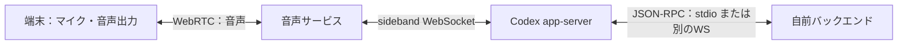

# gpt-live-1-codex と公開 GPT-Live：バックエンド接続の比較

2026-10-19 時点。**ChatGPT 認証の音声セッションにも、バックエンドからの情報投入と音声側からの応答を往復する経路がある。**
新たに `appendText` と `appendSpeech` を使う実機疎通を行い、API キーなしで確認した。
公開 GPT-Live の説明は公式文書、Codex 固有の説明は pin した CLI 0.163.0 のソースと lab の実測を根拠にする。

## モデル名とサービス仕様を分ける

- 公開モデル ID は `gpt-live-1`。モデルカードは audio / text の入出力、streaming、function_calling、Live endpoint を記載する
- CLI v3 の既定モデル名は `gpt-live-1-codex`。ローカルで捕捉した session 作成要求にも同じ値があった。
  ChatGPT 音声の成功経路では model を上書きせず、その既定値を使った
- 両者の重み・snapshot・精度・速度・学習内容が完全に同一か、Codex 版が機能削減版かは確認できない。
  Codex 名の専用公開モデルカードや同一性を確定する資料は、この調査では見つかっていない
- 一方、**認証、URL、イベント名、設定の公開範囲には観測できる違いがある**。
  名前が似ていても API 仕様をそのまま入れ替えない

| 観点 | 公開 API の gpt-live-1 | 今回の gpt-live-1-codex 経路 |
| --- | --- | --- |
| 認証 | Platform project API キー。WebRTC の client credential は公開手順に従う | 既存 ChatGPT ログインを app-server が管理。今回 API キーなしで疎通 |
| 主音声接続 | WebRTC がサーバー間も含め推奨。primary WebSocket も公式対応 | WebRTC v3 / wham を確認。CLI の primary WebSocket はAPIキーを要求して失敗 |
| backend 制御 | 既存セッションへ sideband WebSocket を attach できる | app-server が OAuth の情報を再利用して sideband WebSocket を張る。通知受信と情報投入を実測 |
| backend の選択 | Responses delegation、またはアプリが自前backendを動かす client delegation | Codex の backing thread / handoff が組み込まれている。別backendへ任意に置換する完成機能とは扱わない |
| 設定・操作 | 公開 Live の session / delegation / context API | thread/realtime の実験 RPC と、内部の旧 wire protocol。公開 Live 全設定が使える保証はない |
| 文字起こし | 現行文書は session.input_transcript.delta 等、近似時刻付き | CLI通知は thread/realtime/transcript/delta。今回の無発声運用では最終doneなし、正確な発話時刻の対応は未確認 |
| 画像 | voice frontend の入力はaudio/text。視覚対応backendへ画像を渡し、説明を戻す構成 | カメラ映像をこのvoiceモデルが直接理解することは未実証。別の視覚解析・backendで扱う候補 |
| 費用・制限 | Live の時間とbackendモデル・toolの費用は別扱いという公開仕様 | 今回のログインで動作。全プラン・上限・請求内訳は未測定。公開料金表をそのまま流用しない |

公開モデルの text 入出力という記載は、専用 ASR や text-only 出力設定を保証する意味にはしない。
Codex v3 の outputModality=text は実測で拒否された。無発声の指示で文字起こしだけ取れることと別の話である。

## WebSocket の意味を3つに分ける

### A. サーバーから音声そのものを送る primary WebSocket

公開 API は `wss://api.openai.com/v1/live/sessions` に接続し、API キーで認証、最初に `session.start` を送る。
`session.input_audio.append` の base64 PCM と、応答音声・文字起こし・制御イベントを双方向で運ぶ。
公開文書には PCM16LE mono の16 / 24 kHzやG.711の設定もある。

ChatGPT ログインの現行 CLI には別の制約がある。primary WebSocket の起動前に `realtime_api_key()` を呼ぶため、
キーなしでは `realtime conversation requires API key auth` になった。
これは **CLI の新規音声WebSocket起動経路での失敗**であり、全種類の WebSocket が使えないという意味ではない。
OAuth で primary WebSocket を直接新規開始する独立実装は、この lab では成功を確認していない。

### B. WebRTC の音声セッションへ backend が参加する sideband WebSocket

今回動いたもの。音声は端末と音声サービスの間を WebRTC で流し、別の WebSocket で backend が通知を受け、情報や指示を送る。
**バックエンドも音声処理に関与したいが、マイク音声をサーバー経由にしたくない用途に合う。**



app-server は `create_realtime_call_with_headers()` で SDP を交換し、call ID と認証を保持する。
`sideband_websocket_auth_headers()` は ChatGPT bearer と account 情報を再利用し、
`spawn_webrtc_sideband_input_task()` が sideband の接続・受信・再接続を扱う。
通常の primary WebSocket 起動のAPIキー要求とは別の認証経路である。

pin した CLI の v3 sideband は、既定base `https://api.openai.com/v1` から `wss://api.openai.com/v1/live/{call_id}` を組み立てる。
対して現行の公開 API 文書は `wss://api.openai.com/v1/live/sessions/{session_id}/attach` を案内する。
**call ID と session ID、URL と wire protocol を混ぜない。** Codex で成功したことを、公開attach URLへOAuthを渡せる証拠にもしない。

自前サーバーはまず app-server の RPC を使う案が扱いやすい。トークンを取り出して別のプログラムへ渡す必要はない。
今回の実測は、同一マシンの制御プログラム→app-server の stdio RPC→内部sideband である。
別マシンのサーバー配置、認証情報の安全な配置、app-server自身のWebSocket listenerを公開する構成は未検証。

### C. 自前バックエンドとアプリ・app-server の間の WebSocket

アプリが自分のbackendへ接続する通信は、自分たちのプロトコルとして作れる。
app-server 自身にも JSON-RPC の WebSocket transport があるが、これは OpenAI 音声サービスとの sideband とは別の接続。
非local配置時の認証・TLS・アクセス制御と、実験的transportの扱いを別に設計する。

GPT-Live が任意の `wss://自前サーバー` に勝手に接続することを意味しない。
Live の delegation を受けて、アプリやbackendが必要な処理へルーティングし、結果を音声セッションへ戻す。
backend LLM 自身が Responses WebSocket で OpenAI と通信する場合も、それはまた別の通信路である。

## 今回追加した backend → voice → backend の実測

`tools/sideband_probe.py` は物理マイクを使わず、WebRTC の入力として無音を流す。
接続後、制御プログラムが次を app-server に送った。

1. `thread/realtime/appendText`、role=developer: 「検証用の架空の作業結果です。今回の結果番号は42です。」
2. `thread/realtime/appendSpeech`: 「先ほどアプリから渡された結果番号を、日本語で短く知らせてください。作業の実行や委譲は不要です。」

結果は **「検証の結果、今回の結果番号は四十二です。」**。番号は2の要求に含めず、1の文脈から取得できた。
assistant transcript は WebRTC data channel から転送していない。app-server の通知として受け取り、
ソースで確認した内部sidebandの経路と対応する。受信 PCM も非0で、発話が生成された。

| 計測 | 結果 |
| --- | --- |
| 認証 / CLI | chatgpt、0.163.0 |
| Platform API キー / proxy / 実マイク | すべて使わない |
| peer | connected |
| appendText / appendSpeech | RPC投入成功と、意味を反映した発話を確認 |
| 応答音声 | 320 frames、非0サンプル502,412、peak PCM16=10,312 |
| 通常の Codex turn | 0件 |
| 実時間 | 9.564秒 |

[保存結果](results/backend-sideband-roundtrip.json) は架空のテスト文、応答の文字起こし、計測値のみ。
マイクを録音せず、音声・SDP・IP・OAuth値を保存しない。`appendSpeech` は正確な逐語TTSではなく、言い換える場合がある。
新たなモデル呼び出しを増やさず、保存結果を検算する。

```sh
mise run sideband-probe  # 明示的に選ぶ短い ChatGPT ログインの疎通
mise run                # 保存結果の検算だけ。サービスへ接続しない
```

## 自前の Thinker / backend に繋ぐ際の制約

- backendから文脈や発話要求を送り、結果を音声で伝えるところは確認した。
  音声側の実際のdelegationをアプリ所有の独立Thinkerへ渡し、ツールの検索・計算結果を同じ委譲へ返して音声応答する往復も確認した。[構成と実測](DELEGATION.md) を参照
- Codex の handoff は backing Codex thread にルーティングする実装がある。
  `clientManagedHandoffs` は少なくとも自動の応答返送等を抑える設定であり、これだけで外部backendへの委譲全体を自由に所有できると扱わない。
  Claude / kiapi / 任意サーバーへの接続には、実装の切り分けと明示的な橋渡しが必要
- public API の client delegation は、アプリがbackend、履歴、作業状態、結果の返し方を管理する公式の構成。
  Responses delegation は別の構成で、設定したbackendモデルとtoolsをサービス側が呼ぶ。
  これらの全設定を Codex の実験RPCから選べるとは確認していない
- 文脈の追加、発話要求の投入、ユーザーへの実際の伝達は別の成功条件。
  RPCの `{}` やcontextのackだけで話したと断定しない。音声を止める指示と実際の再生停止も分ける
- 画像・カメラは視覚対応backendへ渡し、結果をtextで音声側へ返す案。voice frontendへの映像直接理解は未実証
- 現行の公開LiveとCodex内の旧イベントは名前や形が違う。publicのSDK例をそのままコピーしない

## 認証の利用範囲と未確認事項

公式 app-server 文書は、既存のlocal / OSSアプリの認証利用と、商用・ホスト型サービスでの利用を区別し、後者のapp-server認証は認めていないと記載する。
技術的にリモートサーバーへ配置できそうなことと、製品の商用backendで利用できる条件は別である。
Sign in with ChatGPT の適用・対応機能も、この音声経路の疎通から自動的に成立するものではない。

全アカウントの利用枠、内部モデルの同一性、課金内訳、長時間sideband、切断復帰、並列・割り込みを伴う委譲、Codex以外のThinkerへの往復、
公開APIでの同条件の品質比較は未確認。今回は既存の実装タスクには着手せず、調査とlabの疎通だけを行った。

## 一次資料

- [gpt-live-1 モデルカード](https://developers.openai.com/api/docs/models/gpt-live-1)
- [公開 primary WebSocket](https://developers.openai.com/api/docs/guides/voice-websockets?api=live)
- [公開 sideband / server-side controls](https://developers.openai.com/api/docs/guides/voice-server-controls?api=live)
- [Live delegation](https://developers.openai.com/api/docs/guides/live-delegation)
- [Live の画像・視覚context](https://developers.openai.com/api/docs/guides/live-delegation#add-images-and-visual-context)
- [app-server 認証の利用範囲](https://learn.chatgpt.com/docs/app-server#auth-endpoints)
- [pinしたCodexの接続・handoff](https://github.com/openai/codex/blob/83086188ae0614bd882818ff1aa23f3194962012/codex-rs/core/src/realtime_conversation.rs)
- [pinしたCodexのsideband](https://github.com/openai/codex/blob/83086188ae0614bd882818ff1aa23f3194962012/codex-rs/core/src/realtime_conversation/sideband.rs)
- [pinしたCodexのOAuth再利用](https://github.com/openai/codex/blob/83086188ae0614bd882818ff1aa23f3194962012/codex-rs/core/src/client.rs)
- [pinしたCodexのWebSocket URL組み立て](https://github.com/openai/codex/blob/83086188ae0614bd882818ff1aa23f3194962012/codex-rs/codex-api/src/endpoint/realtime_websocket/methods.rs)
