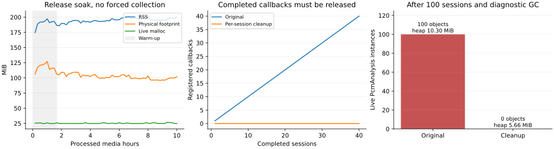

# Flutter FFmpeg and ONNX memory on macOS

## Questions and criteria

Follow the [bounded streaming lab](../flutter-ffmpeg-streaming-input/README.md) at `287872c` in an independent copy. Determine whether the RSS rise comes from retained Dart objects, ONNX tensors/sessions, FFmpeg sessions, live malloc allocations, resident allocator pages, or graphics/runtime caches. Keep the same media, model and dependency versions. Compare no-analysis decoding, VAD without FFmpeg, the combined pipeline and idle control. Do not infer a leak from RSS alone.

Before the long run, require exact PCM/frame counts, bounded app-level retention, zero outstanding inference values between work units and no persistent positive live-allocation trend after warm-up. A final soak must state both wall-clock duration and processed media duration. Profiling GC or malloc pressure relief is diagnostic only; a production stability claim must also hold without periodically forcing them. Native heap counters, VM maps, release and profile modes must not be conflated.

## Results

A real per-session Dart retention defect was found in FFmpegKit's completion callback registry. Releasing each completed session's callbacks removes the retaining root: after 100 sessions and diagnostic GC, each of four analysis classes changes from 100 live instances to zero. The adapted release pipeline passes the predeclared 60-pass memory bounds without forced GC or allocator trimming. The preceding lab and product code/dependencies are unchanged.

| Measurement | Retained result |
| --- | --- |
| Release workload | 60 consecutive ten-minute videos, ten processed media hours |
| Actual elapsed time | 673.106 seconds (11 minutes 13 seconds), accelerated processing |
| Per pass | 9,600,000 PCM samples, 600 JPEG frames, 7,002 VAD-positive chunks |
| Sampled pass-boundary RSS | 174.7–201.8 MiB; final 200.4 MiB |
| Post-warm-up median RSS growth | 5.09 MiB, below the predeclared 8 MiB bound |
| Post-warm-up median footprint growth | −10.96 MiB |
| Post-warm-up live malloc slope | 12.93 KiB/pass, below the 32 KiB/pass bound |
| Outstanding callbacks / ONNX values | Zero at all 60 pass boundaries |
| ONNX sessions | One reused during analysis; zero after close |
| Retained recent voice / image results | At most eight each |

This establishes bounded behavior under this accelerated test, not ten wall-clock hours of operation. RSS still warms up and fluctuates; a positive but bounded measured slope must not be extrapolated indefinitely. Day-long real-time capture and the full multi-model pipeline remain outside this experiment.



Metrics-only source journals, the manifest, diagnostic class counts and the machine-checkable verdict are in [results](results/). The validator enforces the criteria below; failed exploratory prefixes are retained separately and are not counted as accepted trials.

## Predeclared final soak bounds

Run 60 consecutive 600-second traversals (ten media hours), with no forced GC or malloc pressure relief during the accepted release run. Ignore the first ten traversals as warm-up. Require all sample/frame checks to pass, zero completed-session callback registrations and zero native ONNX values at every pass boundary, one active ONNX session and zero after close. Require the late live-malloc slope to stay below 32 KiB/pass, positive median RSS and footprint growth between the first and last ten post-warm-up passes below 8 MiB, and sampled pass-boundary RSS below 512 MiB. These are experiment bounds for this workload, not a general application memory budget. Retain failures and revise the implementation rather than moving the thresholds to fit the data.

## Confirmed retention defect

The pinned `ffmpeg_kit_flutter_new_min` 3.6.7 Dart factory registers each completion closure in `ffmpegSessionCompleteCallbackMap`. Its setter adds entries but neither completion dispatch nor native history eviction removes them. The native history cap of ten sessions does not bound this separate Dart map.

After 100 short sessions, a profile-mode diagnostic GC leaves 100 `PcmAnalysis`, `VoiceDetector`, `SileroVad` and `FrameAnalysis` instances on the original path. VM retaining-path inspection resolves `PcmAnalysis -> context/closures -> Map[100] -> ffmpegSessionCompleteCallbackMap`, a user-global root. After per-session cleanup, the same classes have zero live instances. Managed live heap after diagnostic GC is approximately 10.8 MB versus 5.9 MB. This is a real retention leak, but does not account for every byte of the earlier RSS warm-up.

This lab's adapter removes only the completed session ID from the six pinned callback/strategy registries in its `finally` block, after completion and socket cleanup. It does not clear all sessions or another active operation's callbacks. Regression tests cover isolation and idempotence. This is an intentionally version-coupled workaround using the pinned package's internals, not an upstream release or a change to product dependencies.

The local ONNX probe reports native dictionary counts under the existing lock; it does not change inference/disposal. Values are zero at every completed work unit, the session count is one during reuse and zero after close. The native ONNX session/value registries are not the observed retaining root.

## Diagnostic boundaries

Profile mode is used only to inspect managed heap and retaining paths. Its GC requests are diagnostic and its RSS is not compared directly with release mode. `malloc_zone_statistics` distinguishes used malloc bytes from reserved allocation space; `TASK_VM_INFO` adds physical footprint. RSS also includes residency/caches outside live application allocations. The initial pressure-relief probes returned zero bytes and therefore do not establish that forced allocator trimming is useful.

The first release prefix overlapped profiling processes and was intentionally stopped; separate unmarked two-thread and one-thread prefixes had variable processing times. None is accepted as the final soak. All three are preserved as exploratory evidence. Final controls and the final soak run serially, with profiling processes closed. Three-pass profile checks of one versus two ONNX threads returned the same sample/VAD results and similar completion time (approximately eleven seconds per ten media minutes); the final soak explicitly uses one inference thread rather than adding an unnecessary worker. This runtime choice is separate from the callback-retention fix, which is demonstrated under the original two-thread configuration.

## Reproduce and inspect

Use Flutter 3.47.2 / Dart 3.13.2 on macOS 14+ (the retained runs use M1 Max 64 GB and macOS 27.0.1). The media fixture and VAD are identical to the preceding lab. Native decoder/inference dependency versions remain FFmpegKit min 3.6.7 / FFmpeg n8.1.2 and flutter_onnxruntime 1.9.0 / ONNX Runtime 1.28.0. The latter is a local MIT-licensed copy with only a native live-registry counter added; the global package cache is untouched. The pinned model is Silero VAD. Nothing is sent to paid APIs.

```sh
mise run prepare             # shared video/model, repeated ten-minute MP4, PCM control fixture
mise run check               # consumer and per-session cleanup tests
mise run soak                # 60 ten-minute release passes, one ONNX inference thread
mise run                     # tests plus validation of the retained completed results
mise run plot                # matplotlib 3.11.2, renders the retained data
```

The app consumes these environment settings: `RUN_LABEL`, `RUN_MODE=full|decode|infer|idle`, `PASSES`, `MEDIA_SECONDS`, `ORT_THREADS`, `CLEAN_CALLBACKS`, `GAP_MS`, `WORK_ACTIVITY`, `RELIEVE_AT_END` and `STAY_ALIVE`. A unique label writes a flushed JSONL journal to `getApplicationSupportDirectory()/LABEL.jsonl`. Raw video/audio are never appended to the journal. `tools/run.sh` builds release by default (`BUILD_MODE=profile` for diagnostics); direct binary invocation avoids rebuilding for each condition. Finish or copy a running app before rebuilding the same product.

- A/B retention: run fresh release processes with `RUN_MODE=full MEDIA_SECONDS=6 PASSES=40`, once with `CLEAN_CALLBACKS=0` and once with `1`.
- Profile heap/retaining paths: build profile and run 100 six-second sessions with `GAP_MS=500 STAY_ALIVE=1`, once per cleanup setting. `tools/vm_probe.mjs LOG OUTPUT --gc` uses the per-process VM service from the ignored log. It requests a diagnostic GC, reports live class counts and a sanitized retaining path. Never publish the service auth URI.
- Controls: `CONTROL_PASSES=8 tools/run_controls.sh` serializes idle, decode-without-VAD and predecoded-PCM-with-VAD in fresh processes. Run a one-pass idle app first if its sandbox container does not exist; the script stages the PCM fixture in that existing container. The sandbox correctly rejects an arbitrary repository path; the failed first control was corrected by staging the same bytes, not by disabling the sandbox.
- Accepted soak: `RUN_LABEL=soak-fixed RUN_MODE=full ORT_THREADS=1 MEDIA_SECONDS=600 PASSES=60 CLEAN_CALLBACKS=1 WORK_ACTIVITY=1`, release. No other profiling/test instance is active. `tools/export.py` exports completed, metrics-only journals and diagnostic results; `tools/validate.py` checks the predeclared bounds.

The Swift probe reports `malloc_zone_statistics` for all zones and `TASK_VM_INFO` resident size / physical footprint. `malloc_zone_pressure_relief` is an optional diagnostic at the end of a control, never part of the accepted soak. VM-map/sample output remains ignored because it includes process/local details; it was used only as supporting inspection, not as an interchangeable RSS/footprint metric. The user does not need to change system memory settings or disable App Sandbox.

## Scope and interpretation

This fixes a per-session Dart retention defect in the lab adapter. It does not modify the upstream package, promise that arbitrary library versions expose the same internal names, or establish that all models/backends are leak-free. Updating FFmpegKit requires revisiting this workaround. A production integration should own the callback lifecycle and preserve callbacks for concurrent active sessions; clearing all callback maps is unsafe.

The accepted soak applies to one reused CPU Silero session, PCM/JPEG streaming and bounded recent metadata. It excludes Whisper, speaker embeddings, CLAP, multiple simultaneous brains, GPU inference, mobile/Web lifecycles and day-long real-time capture. Processed media hours are not wall-clock hours. A stable bound over this accelerated workload is evidence for the configuration, not a proof for unlimited operation. Natural allocator/runtime warm-up is distinguished from confirmed retained application objects; the callback cleanup does not imply every RSS increase was leaked state.

Sources: [pinned FFmpegKit package](https://pub.dev/packages/ffmpeg_kit_flutter_new_min/versions/3.6.7), [ONNX Flutter package](https://pub.dev/packages/flutter_onnxruntime/versions/1.9.0), [Dart allocation profile API](https://pub.dev/documentation/vm_service/latest/vm_service/VmService/getAllocationProfile.html). Exact defect and workaround locations are the pinned factory's `lib/src/ffmpeg_kit_factory.dart`, the copied adapter's `app/lib/backend_native.dart` and `app/lib/probe.dart`. The local dependency's provenance is recorded in `packages/flutter_onnxruntime_probe/PROBE.md`.

The accepted finite job marks its active work with macOS `beginActivity(.userInitiatedAllowingIdleSystemSleep)` and ends the activity in `finally`. This is process-local and leaves system sleep settings unchanged; idle system sleep remains allowed. Unmarked exploratory runs showed large scheduling-time variation after a few passes. This observation is not proof of App Nap causation. The explicit activity hint follows the OS API for a user-started finite export/analysis job; it is recorded separately from the memory cleanup. The unmarked prefixes remain exploratory, not accepted soak results.

## Completed controls

Eight-pass fresh-process controls separate the components. Idle RSS stays at approximately 124 MiB; decoding/JPEG validation without inference stays at approximately 151 MiB. The predecoded-PCM/VAD control also completes with zero native values and no FFmpeg session/callback accumulation. This narrows the confirmed object-retention cause to the completed-session closures, rather than an accumulating ONNX value registry or the elementary decoder path. A fresh process, profile/release mode and workload differ, so these control RSS values are not additive memory budgets.

The first arbitrary-path PCM control was rejected by App Sandbox. It was rerun successfully with the same PCM staged in the initialized app container. Exploratory prefixes stopped during concurrent profiling or variable unmarked scheduling are not used for the final acceptance calculation. They remain available as labeled non-accepted observations, rather than being silently omitted.
