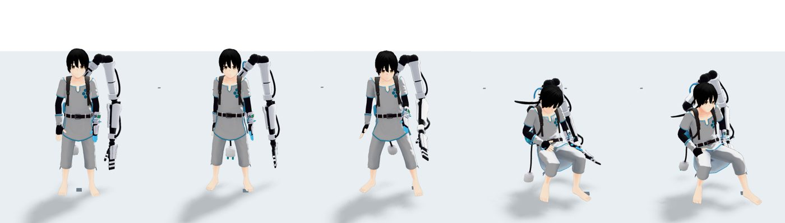
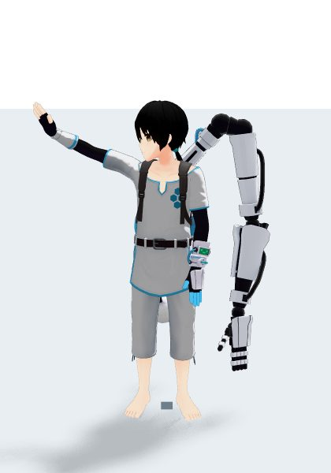

# LLM エージェントが、ARDY Mini（文から動きを作るモデル）で Flutter の VRM の体を動かす

Flutter（macOS）のアプリで、LLM エージェント（Codex の thread）が「A person waves with the right hand.」のような英文を道具で出し、
[ARDY Mini](https://huggingface.co/intsuc/Llama-3-ARDY-Mini-Core40-Browser)（NVIDIA の ARDY を WebGPU で動くようにした派生）がその動きを作り続け、
[flutter_vrm](https://github.com/kiarina/flutter_vrm) の VRM の体に流せるかを確かめます。



関連: [spirit-canvas](../spirit-canvas/README.md)（同じ Codex の thread の作りと、Flutter の WebView の扱い。`../../../../docs/flutter-webview.md`）

## Purpose

1. ARDY Mini（ONNX Runtime Web の WebGPU 専用）を、Flutter のアプリの中の WebView（macOS の WKWebView）で動かせるか
2. 作った動きを flutter_vrm の正規化ボーンへ写して、途切れずに再生できるか（生成は再生より速いか）
3. LLM エージェントが会話の流れで動きを選び、指示から体が動くまでどれくらいかかるか

評価は、アプリの制御用 API（`/status`・`/screenshot`）で取る時間・止まった回数と、画面の撮影を目で見ることで行いました。

## Answer

- **動いた。** WKWebView の中で WebGPU が使え、`shader-f16` もあって fp16 版が選ばれた。モデルの 3 つの ONNX（約 650 MB）を読み込み、40 フレーム（20 FPS で 2 秒分）ずつ作り続けて、VRM の体が手を振る・跳ぶ・歩く・座る・踊った
- **生成は再生より速い。** 最初の 1 回は 5.2〜6.1 秒（初回のシェーダーの準備などを含む）。続きの 40 フレームは 0.68〜1.3 秒（2 秒分の動き）で、再生が生成を待って止まったことは、窓が見えている間は 1 度もなかった
- **エージェントの指示から体が動くまで、ターンの開始から 2.8〜4.2 秒。** 内訳は、LLM が `move` を呼ぶまで 1.9〜3.1 秒（gpt-6.1-terra、effort low）、そこから新しい動きが画面に出るまで 0.83〜1.06 秒。
  後者の大半は ARDY Mini の「1 秒先から切り替える」仕組み（20 フレームの余白）によるもので、生成そのものは 0.73〜1.05 秒
- **エージェントは会話に合った英文を自分で作った。**「一緒に喜んで」→ `A person jumps up and down with both arms raised.`、「疲れたでしょ」→ `A person sits down and rests.` など、5 ターンすべてで `move` を 1 回呼んだ
- **モデルの読み込みが重い。** キャッシュ済みでも、起動から使えるまで 76〜119 秒（窓が見えているとき）。大半は 3 つの ONNX のセッション作成（WebGPU のシェーダーの準備）とみられるが、内訳は測っていない
- **窓が隠れていると止まる。** 窓が他の窓の後ろにあった回は、読み込みが 231 秒、生成が 1.4〜4 秒に遅くなり、Flutter のフレームが進まず再生もほぼ止まった（[run5-hidden-window.jpg](results/run5-hidden-window.jpg)。T ポーズや同じ絵が並ぶ）。
  再生をフレームの刻みで進めているため。常に見せておく使い方が前提
- **落とし穴: 歩く動きで hips を原点から遠くへ動かすと、髪が消えた。** スキンメッシュの描画の範囲が休みの姿勢の場所のままになり、カリングされたとみられる（[walk-hips-only-hair-culled.jpg](results/walk-hips-only-hair-culled.jpg) の右端）。
  ARDY Mini 自身のビューアと同じく、水平の移動は VRM の根のノードを動かし、hips には高さだけを渡すと消えなくなった（[walk-root-motion.jpg](results/walk-root-motion.jpg)）

## 計測（MacBook Pro M1 Max 64GB、macOS 27.2.1、窓が見えている回）

エージェントとの 5 ターン（`drive.py`、run 4）。ターンは Codex の `turn/start` から `turn/completed` まで。「画面に出る」は、新しい動きの最初のフレームを再生が通った時刻。

| 発言 | エージェントが選んだ動き | ターン | `move` まで | 生成（40 フレーム） | 指示 → 画面に出る |
| --- | --- | ---: | ---: | ---: | ---: |
| こんにちは！ちょっと手を振ってみて | A person waves with the right hand. | 4.9 s | 3.0 s | 0.75 s | 0.83 s |
| 今日はいいことがあったんだ。一緒に喜んで！ | A person jumps up and down with both arms raised. | 4.3 s | 2.1 s | 0.73 s | 0.92 s |
| ちょっと向こうまで歩いてきて | A person walks forward slowly. | 3.4 s | 1.9 s | 0.91 s | 0.94 s |
| 疲れたでしょ、座って休んでいいよ | A person sits down and rests. | 4.8 s | 2.0 s | 0.74 s | 0.95 s |
| 最後にダンスを見せて | A person dances happily, moving both arms and stepping from side to side. | 5.2 s | 3.1 s | 1.05 s | 1.06 s |

- 再生が生成を待った回数: 0（run 4 の全体）。描画は 120 fps（デバッグ build）
- 続き（append）の 40 フレームの生成: run 4 は 0.68〜0.85 秒、直接指示した回（run 1）は 1.2〜1.3 秒。回によってばらつく理由は分かっていない
- 内訳の例（続きの 1 回）: 文のエンコード 27 ms、拡散（10 ステップ）627 ms、デコード 21 ms
- モデルの読み込み（キャッシュ済み）: 76 秒（run 2）、119 秒（run 4）、231 秒（run 5、窓が隠れていた）。初回のダウンロードを含む回は測っていない



## How it works

```text
app/                      Flutter（macOS）
  lib/main.dart           画面（VRM・WebView・会話）、道具 move、制御用 API（CONTROL_PORT）
  lib/agent.dart          codex app-server の thread 1 本（spirit-canvas の spirit.dart を写したもの）
  lib/rpc_client.dart     codex app-server との JSON-RPC（同上）
  lib/bridge.dart         web/dist を配るループバックの HTTP サーバーと、WebView とのやり取り
  lib/motion.dart         動きのタイムライン・再生位置・続きの生成と切り替え、VRM への書き込み
web/                      WebView の中のページ（UI なし）
  src/main.ts             推論ワーカーとアプリの橋渡し。生成した塊を VRM の正規化ボーンの回転へ写して送る
  src/ardy/               ARDY Mini の web/src から写したもの（runtime/・推論ワーカー・motion-data・vrm-retarget）
drive.py                  制御用 API で会話を流し、撮影と計測を出す
```

- **推論は ARDY Mini の推論ワーカーをそのまま使う。** ページはワーカーにモデルの読み込み（`loadModel`）と生成（`generate` の `replace`・`append`・`branch`）を頼むだけ。
  モデルは Hugging Face の固定した commit（`1c21362e`）から取り、ページの Cache Storage に残る
- **VRM への写し方も ARDY Mini のもの（`vrm-retarget.ts`）。** Core27 の骨の大域の回転から、VRM の正規化ボーンの局所の回転を作る。flutter_vrm の正規化ボーン
  （VRM 1.0 のモデル空間、+X が左、+Z が前）は three-vrm と同じ約束なので、四元数をそのまま `setNormalizedRotation` に渡せた
- **タイムラインはアプリ（Dart）が持つ。** 残りが 30 フレームを切ったら同じ文で続きを作る。文が変わったら、再生位置の 20 フレーム先から作り直す（ARDY Mini のアプリと同じ）。
  生成中に新しい文が来たら、終わってから作り直す
- **エージェントの道具は `move` 1 つ。** 指示（`_instructions`）で、英文の「A person ...」の形で書くこと、動きは次の `move` まで続くこと、返事は日本語で短くすることを伝えた

## 実行

```sh
mise run build          # web/dist（npm）と macOS のアプリ（Flutter）
CONTROL_PORT=18795 mise run run
python3 drive.py 18795 work/frames/   # 別の端末で。会話を流して撮影と計測を出す
```

- VRM は `VRM_PATH`（既定は `work/assets/Seed-san.vrm`。Git に入れていない。VRoid の Seed-san など VRM 1.0 を置く）
- エージェントのモデルは `MODEL`（既定 `gpt-6.1-terra`）、`EFFORT`（既定 `low`）。`AGENT=0` でエージェントなし（右の欄の「motion」に英文を直接入れられる）
- Codex の CLI（`codex app-server`）とそのログインが要る。モデルの一覧は `~/.codex/models_cache.json` から読む
- 初回はモデル（fp16 で約 650 MB、fp32 で約 685 MB）をダウンロードする

### 落とし穴

- `Info.plist` に `FLTEnableFlutterGPU` が要る（flutter_scene）。無いと例外の赤い画面になる
- `flutter create` の既定の Swift Package Manager の Xcode プロジェクトは、2 回目の build で「Cycle in dependencies between targets 'Runner' and 'Flutter Assemble'」で落ちた（Xcode 27.2）。
  CocoaPods へ切り替えても、`flutter clean` しない build は「Cycle inside Flutter Assemble」で落ちた。`flutter clean` してからだと通る。`mise run build` は落ちたら clean してやり直す
- ARDY Mini のマニフェストの `skeleton` は生の形（`joint_names` など）なので、`vrm-retarget.ts` に渡す前に `normalizeSkeletonMetadata` を通す。通さないと例外になり、ワーカーのイベントの中で黙って消えた

## 環境

- MacBook Pro M1 Max 64GB、macOS 27.2.1、Xcode 27.2
- Flutter 3.47.2、`webview_flutter` 4.14.x（WKWebView）、flutter_vrm `6cdf97d`、flutter_scene `0e263beb`
- Node 22、onnxruntime-web 1.27.0、@huggingface/tokenizers 0.1.3、vite 8.1.5
- ARDY Mini のソース `intsuc/ardy-mini@5e9ce2da`、モデル `intsuc/Llama-3-ARDY-Mini-Core40-Browser@1c21362e`
- Codex CLI 0.172.0、gpt-6.1-terra（effort low）

## 結論が成立する範囲・未確認のこと

- macOS（WKWebView）の 1 台だけ。iOS・Android・Windows の WebView で WebGPU と `shader-f16` が使えるかは見ていない
- エージェントのモデルは 1 つ、会話は 1 本（5 ターン）。英文の質で動きがどれだけ変わるかは比べていない
- 動きの質は目で大筋を見ただけ。足の滑り・接地・つなぎ目の不自然さは評価していない。指の骨は親指の付け根だけ動き、ほかの指は休みの姿勢のまま
- 読み込みの時間の内訳（キャッシュの検証・セッション作成）は分けて測っていない
- `drive.py` の 4 枚ずつの撮影は、窓が隠れていた回（run 5）しか取れていない

## ライセンス

- `web/src/ardy/` は ARDY Mini（Apache-2.0、Copyright (c) 2026 intsuc。ARDY 本体は NVIDIA）から写したもの。`vrm-retarget.ts` は three-vrm の型の import を、この lab の中の別名に変えた。
  元の `LICENSE`・`NOTICE` と ONNX Runtime のライセンスは `web/notices/`
- モデルの重みはこのリポジトリに含めず、実行時に Hugging Face から取る。モデルは複合の条件（動きのモデルとデコーダーは NVIDIA Open Model License、文のエンコーダーは all-MiniLM-L6-v2 由来で Apache-2.0、教師は Meta Llama 3）で、
  詳細はモデルのページの `MODEL_TERMS.md`。Licensed by NVIDIA Corporation under the NVIDIA Open Model License.
