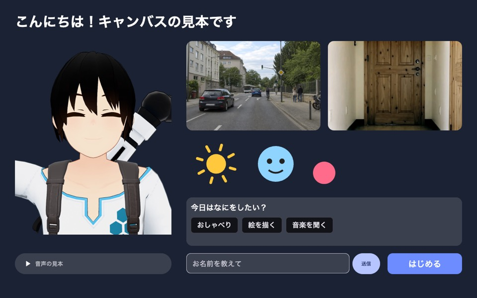

# A canvas mode for a spirit's chat: gpt-6.2-sol lays out text, SVG, a VRM body, media and buttons with tools; then actions, timelines and spirit-written JavaScript run on the canvas without the model

チャットの画面に「キャンバス」のモードを足し、spirit（Codex の thread）が道具でキャンバスに好きなものを置けるかを確かめます。
入力欄はそのままです。上の履歴の代わりに、spirit が文字・絵・3D の自分の姿・写真・動画・音声・ボタン・選択肢・入力欄を座標を決めて置き、
アニメーションさせます。ユーザーが押した・選んだ・入れたことは、spirit へのメッセージとして返ります。


## Purpose

1. Flutter のアプリで、宣言した要素（JSON）だけからこの種類の画面を描けるか。VRM・動画を含めて、spirit が見るための画像に撮れるか
2. 本番級のモデル（gpt-6.2-sol）が、座標で配置して崩れない画面を自分で組めるか。押された・選ばれたことに画面で応えられるか
3. 1 画面にかかる時間とトークン。どこが重いか

評価は、画面の撮影（`canvas_view` と同じ撮り方）を目で見ることと、ターンごとの時間・道具の回数・トークン（Codex の `thread/tokenUsage/updated`）で行いました。

## Answer

- **作れた。** 見本（モデルなし）で 10 種類の要素がすべて描け、`RepaintBoundary.toImage` の撮影に VRM（flutter_scene）と動画も写った。アニメは止まらずに回る
- **gpt-6.2-sol は、整った画面を自分で組んだ。** 自己紹介では、カードの文・飾りの星・全身の VRM・「手を振り返す」ボタンを配置し、`canvas_view` で見て位置と構図を直した。
  季節の問いでは 4 枚の SVG の絵と選択肢を出し、「秋」を押すと夕暮れの川辺を描き直して、紅葉 6 枚に別々の軌道のアニメを付けた
- **画面のボタンを実際に押すと spirit に届き、画面で応えた。** 「手を振り返す」を押すと、VRM を `cheer` のポーズと `happy` の表情にし、星を脈打たせた（10 秒、道具 2 回）
- **遅い。** 新しい画面を作るターンは 50 秒〜4 分。特に SVG の絵を描くターンは、出力が 8,000〜11,000 トークンになり、最初の道具の呼び出しまで 12〜21 秒かかった
- **`canvas_view` が自分の書いた SVG を毎回全文返していたのが、入力を膨らませていた。** 長い SVG を長さだけにすると、同じ「秋の絵」のターンの入力が 435,461 → 178,919 トークン、時間が 240 → 168 秒になった（絵は別物なので条件は揃っていない。下の表）
- チャットのモードでは道具を使わずに普通に返した（6 秒）。チャットのまま「絵で見たい」と頼むと、キャンバスに描いて「切り替えると見える」と案内した
- **Part 2: spirit を通さずに動かす仕組み（要素の `on`、状態と `{{name}}`、タイムライン、spirit が書く JavaScript、通知の区別）を足すと、押したときの反応が 4〜9 ms になった。**
  Sol は 4 つのシナリオをすべて自分で書いたスクリプトで作り、タイマーの終わりにはスクリプトから spirit を起こした（[Part 2](#part-2-spirit-を通さずにアプリだけで動かす)）

| | |
| --- | --- |
|  |  |
| 見本（モデルなし）。左は VRM（`wave`、`happy`）、右上は写真と動画、太陽は回転、顔は 2 コマのパラパラ、丸は跳ねる | 自己紹介。spirit が組んだもの（VRM は `framing: full`） |
|  |  |
| 「好きな季節を選択肢で聞いて」。4 枚の絵は SVG で spirit が描いた | 手元の写真・動画・音声で「街の一日」。朝・午後・夜の切り替えと再生はボタン |

## How it works

```text
app/lib/
  main.dart               画面（チャット / キャンバスの切り替え、入力欄、字幕）、道具の実行、イベントを spirit へ
  spirit.dart             codex app-server の thread 1 本（dynamicTools、code mode を切ったモデル表）
  spirit_tools.dart       道具の定義（JSON Schema）と spirit への指示
  canvas/canvas_model.dart  要素・アニメ（キーフレーム）・イベント
  canvas/canvas_view.dart   1280x800 の舞台を窓に合わせて縮める。要素ごとの描画、撮影
  canvas/vrm_element.dart   VRM（flutter_vrm）。ポーズ・表情・.vrma・構図・口パク
  control_server.dart     検証用のローカルの HTTP（送る・モード・イベント・撮影・状態）
  demo_scene.dart         モデルを使わない見本
drive.py / wait_turn.py   検証の操作と記録
```

### 道具

| 道具 | すること |
| --- | --- |
| `canvas_view(image?)` | 今のキャンバスを画像と要素の一覧で見る。ユーザーがどちらのモードかも返す |
| `canvas_put(elements[])` | 要素を置く（同じ id は置き換え）。1 回で画面全体を置ける |
| `canvas_update(id, props, transition_ms?, easing?)` | 一部の属性を変える。`transition_ms` で位置・大きさ・透明度などをなめらかに動かす |
| `canvas_animate(id, keyframes[], duration_ms, repeat, alternate, easing)` | キーフレームのアニメ。アプリが再生し、spirit はフレームごとに呼ばない |
| `canvas_remove(ids)` / `canvas_clear(background?)` | 消す |
| `canvas_media()` | 見せてよい写真・動画・音声・VRM・VRMA の名前 |

要素の種類は `text`・`shape`・`image`・`svg`（`frames` でパラパラ）・`video`・`audio`・`vrm`・`button`・`choices`・`input`。
すべて `id`・`x`・`y`・`w`・`h` を持ち、`z`・`opacity`・`scale`・`rotation`・`tappable` が共通です。属性の一覧は `spirit_tools.dart` の `_elementSchema`。

ユーザーの操作は `press`（ボタン）・`choose`（選択肢）・`submit`（入力欄）・`tap`（`tappable` の要素）・`ended`（動画・音声の終わり）で、
250 ms 以内のものをまとめて 1 通にし、`<canvas_event event="press" id="..."/>` の形で送ります。spirit の turn が動いていれば `turn/steer` で差し込みます。
ユーザーのメッセージにも毎回 `<ui mode="canvas"/>` を付けて、今どちらを見ているかを渡します。spirit の普通の返事は、キャンバスの下に字幕として出ます。

キャンバスの大きさは 1280x800 の固定で、窓に合わせて縮めます（spirit がいつも同じ座標で置けるように）。チャットのモードの間もキャンバスは描かれ続けます（spirit が見られるように）。

### Codex の設定

[司令塔の lab](../../../10/06/flutter-agent-orchestrator/README.md) と同じく、道具は `thread/start` の `dynamicTools`（`experimentalApi`）。
[API のように使う lab](../../../10/07/agent-runtimes-as-llm-api/README.md) で見つけた code mode を、`~/.codex/models_cache.json` を写して `tool_mode` などを null にしたモデル表（`model_catalog_json`）で切ります。
code mode のままだと道具の結果が 1 つの文字列になり、`canvas_view` の画像が画像として届きません。シェル・Computer Use・ブラウザなどの機能は thread ごとに切っています。

## Results

条件: MacBook Pro（M1 Max、macOS）、Flutter 3.47.2（Dart 3.13.2）、Codex CLI 0.172.0、`gpt-6.2-sol`（推論 effort は既定の low）、
ChatGPT のサブスクで実行。各シナリオ 1 回ずつ（ばらつきは見ていない）。

1 本の thread で続けて流した（s1〜s7）。トークンは累計の差分。「道具」の括弧内は `canvas_view` の回数。

| シナリオ | 時間 (s) | 最初の道具まで (s) | 道具 | 入力 | うちキャッシュ | 出力 |
| --- | ---: | ---: | --- | ---: | ---: | ---: |
| s1 自己紹介して | 56 | 4 | 10 (5) | 139,692 | 108,672 | 1,635 |
| s2 「手を振り返す」を押す（画面で実際にクリック） | 10 | 3 | 2 (0) | 51,124 | 50,432 | 177 |
| s3 好きな季節を選択肢で聞いて、答えたら絵を | 57 | 6 | 5 (2) | 121,399 | 113,536 | 2,325 |
| s4 「秋」を選ぶ（画面で実際にクリック） | 240 | 21 | 12 (2) | 435,461 | 395,264 | 10,773 |
| s5 写真・動画・音声で「街の一日」 | 116 | 3 | 10 (3) | 589,465 | 578,432 | 4,150 |
| s6 チャットのモードで朝ごはんの相談 | 6 | — | 0 | 59,007 | 58,624 | 166 |
| s7 チャットのまま「それ、絵で見てみたいな」 | 121 | 20 | 3 (1) | 253,026 | 242,176 | 5,339 |

`canvas_view` が長い SVG（300 文字を超える `markup`・`frames`）を長さだけ返すようにして、新しい thread で s3・s4 を流し直した:

| シナリオ | 時間 (s) | 最初の道具まで (s) | 道具 | 入力 | うちキャッシュ | 出力 |
| --- | ---: | ---: | --- | ---: | ---: | ---: |
| v2-s3 好きな季節を…（同じ文） | 49 | 4 | 3 (2) | 41,978 | 29,056 | 2,043 |
| v2-s4 「秋」を押す | 168 | 12 | 8 (1) | 178,919 | 167,168 | 7,845 |

- v2-s4 の差分には、間に挟まった空のイベントの 1 ターン（下の「失敗した試行」、入力 12,605）を含む
- v2 では spirit が選択肢ではなく 4 つのボタンで季節を聞いた。描いた絵も別物（[v2-s3](results/v2-s3-ask.jpg)、[v2-s4](results/v2-s4-choose.jpg)）で、比べは「同じ依頼で入力がどれだけ減ったか」の目安にとどまる
- 各ターンの記録（道具の引数・結果の先頭、要素の一覧）は `results/*.json`。長い文字列は 2,000 文字を超えると切ってある

### 観測したこと

- spirit は `canvas_view` で自分の画面を見て直した（s1 で 5 回）。直したのは位置・大きさ・VRM の構図で、文字のはみ出しはどのシナリオでも起きなかった
- s4 で spirit は、最初に 1 枚の SVG で背景を描き、葉を別の要素にして `canvas_animate` を 6 回、川面の光に 1 回呼んだ。そのあと見て、木の葉の層を別の SVG で足した
- 字幕として出る spirit の最初の一言（「キャンバスで、手を振ってごあいさつするね。」）は道具の前に出るので、待っている間の手がかりになった
- s5 の「朝・午後・夜」の切り替えボタンは、押すたびに spirit への往復になる作り（spirit が押されたら `canvas_update` で動画を替える前提）。押したときの反応は s2 から見て 10 秒前後になるはず（押していない）
- s7 で spirit はチャットのモードのまま描き、`canvas_view` の `mode: chat` を見て「切り替えると見える」と書いた。モードを切り替える道具は無い

### 失敗した試行・都合の悪い結果

- **VRM が背中を向けた。** 最初の版の `framing: full` は、カメラを +Z に置いていた。flutter_vrm の `VrmPortrait.bust` が返す向きを使うように直した。直す前の s1 で、spirit は撮影を 5 回見たが背中であることには触れず、そのまま「はじめまして」と返した
- **検証のスクリプトの誤り:** v2 で選択肢を探すスクリプトが、ボタンで聞かれたため空の `choose` イベントを送った。spirit は「季節がまだ選ばれていないみたい」と返した（5 秒）。そのあと「秋」のボタンを押し直した
- **2 回目以降のビルドが Xcode で失敗した。** `Cycle in dependencies between targets 'Runner' and 'Flutter Assemble'`。`build/macos` だけを消しても直らず、`flutter clean` からなら通った。
  そこで設定を `--dart-define` から環境変数に変え、`mise run build`（clean から）と `mise run run`（ビルド済みのアプリを環境変数付きで起動）に分けた
- `codex app-server` の既定のモデルは `gpt-6.2-astra` だった。この lab では `MODEL` の既定を `gpt-6.2-sol` にしている

## Part 2: spirit を通さずにアプリだけで動かす

Part 1 では、押すたびに spirit を往復した（ボタン 1 回で約 10 秒）。spirit が考えるのは組み立てるときだけにし、動かすのはアプリに任せる仕組みを足した。

### 足したもの

| | すること |
| --- | --- |
| 要素の `on` | 押した・選んだ・入れた・タップ・終わったときに、アプリがその場で動作の列を行う（`update`・`animate`・`put`・`remove`・`set`・`add`・`timeline`・`notify`）。`choose` は値ごとに分けられ、`$value` で値を差し込める |
| 要素の `notify` | ユーザーの操作をどう spirit に伝えるか。`now`（起こす）・`later`（次に話すときにまとめて渡す）・`none`。既定は、キャンバスの上で誰も扱わなければ `now`、`on` かスクリプトが扱えば `later` |
| 状態と `{{name}}` | 共有の値。文字・ボタンの文字の `{{name}}` に差し込まれ、値が変わるとすぐ表示も変わる。spirit は `canvas_state` で一部だけ書き換えられる |
| `canvas_timeline` | 時刻ごとの動作の列。繰り返し・1 周の長さを指定できる |
| `canvas_script` | spirit が書く JavaScript を、アプリの中で動かす。`sg.every`・`sg.after`・`sg.on`（操作・状態）・`sg.set`・`sg.update`・`sg.put`・`sg.animate`・`sg.notify(text, {wake})` |
| 通知 | 後回しの通知（`<canvas_notice>`、`handled` の付いた `<canvas_event>`）は、次に spirit へ送るメッセージの先頭にまとめて付く。起こす通知は 5 秒に 1 回までに間引き、間のものはまとめて送る |

スクリプトは、`flutter_js` 0.8.7 の 1 つの JavaScript の文脈（macOS では JavaScriptCore）で、fetch・XHR を入れずに動かす。
タイマーは JavaScript 側に持ち、アプリが 50 ms ごとに `__sg.tick` を呼ぶ。スクリプトからアプリへは `sendMessage` で、値を同期で返す。
ハンドラの中の例外は spirit への通知になり、3 回落ちたスクリプトは止める。読み込みの時点の構文エラーは道具の結果で返る。

**安全の範囲（lab の時点）:** ネットワーク・ファイル・DOM は無い。ただし、無限ループは止められない（UI と同じスレッドで同期に動くため、アプリが固まる）。製品にするなら、別の isolate かプロセスと実行時間の上限が要る。

### モデルなしの確認

`/tool` で道具を直に呼んで確かめた（`results/behaviors-demo.jpg`）: 毎秒進む時計（スクリプトが `sg.set`、文字は `{{time}}`）、`on` で数える回数と星のアニメ、0.7 秒ごとのスライドのタイムライン、
3 の倍数でスクリプトが後回しの通知を残す、構文エラーが道具の結果で返る、毎回落ちるスクリプトが 3 回で止まり通知は 2 件だけ残る。単体テスト（`test/behaviors_test.dart`）で `on`・`choose` の振り分け・テンプレート・タイムライン・通知の間引きを見ている。

### gpt-6.2-sol に流した結果

新しい thread で、b1〜b4 を続けて流した。

| シナリオ | 時間 (s) | 最初の道具まで (s) | 道具 | 入力 | うちキャッシュ | 出力 |
| --- | ---: | ---: | --- | ---: | ---: | ---: |
| b1 地理クイズを 3 問、答えたらその場で正誤と点数 | 69 | 14 | clear, put, script, view | 60,822 | 32,384 | 2,868 |
| b1 を解いた後「終わったよ！どうだった？」 | 31 | 5 | view, put, view | 68,858 | 61,184 | 1,160 |
| b2 1 分のタイマーと時刻、スタートボタン、終わったら声をかけて | 50 | 11 | media, clear, put, script, view | 127,650 | 122,624 | 2,066 |
| b2 のタイマーが終わってスクリプトが spirit を起こした | 2 | — | — | 23,444 | 23,040 | 21 |
| b3「タイマーは 3 分、時刻はオレンジに。ほかはそのまま」 | 24 | 20 | script, view | 73,016 | 62,208 | 982 |
| b4 自己紹介を 3 枚のスライドで 4 秒ごと、最後に「もう一度」 | 79 | 11 | view, clear, put, view, script, view | 198,340 | 184,704 | 3,365 |

| | |
| --- | --- |
|  |  |
| b1 を 3 問解いた後。答え合わせ・点数・進み具合・次へはすべてスクリプト | b2 の集中タイム |

spirit が書いたスクリプトは `results/scripts/`（46〜61 行）。

- **押したときの反応が、spirit の往復なしになった。** クイズの選択・次へを 5 回押し、押してから画面の値が変わるまで 4〜9 ms（制御のポートから押して状態を読むまで。描画の時間は含まない）。その間 spirit は一度も起きなかった
- **時間で spirit を起こせた。** タイマーのスタートを画面で実際にクリックし、ちょうど 1 分後にスクリプトが `sg.notify(..., {wake: true})` で起こした。spirit は道具を使わず 2.5 秒で「1分経ったよ。集中タイム終了、おつかれさま！」と返した
- **Sol は 4 つとも JavaScript のスクリプトで作った。** `on`・`canvas_timeline`・`canvas_state` は一度も使わなかった。スライドショー（b4）もタイムラインではなくスクリプトだった
- **spirit は答えのボタンに自分で `notify: "none"` を付けた。** 押されたことを自分に知らせない選択で、「どうだった？」と聞かれると `canvas_view` で画面を読み、「3問中2問正解、第2問の正解は琵琶湖」と答えた（31 秒）
- **「ほかはそのまま」の部分の変更（b3）は、スクリプトの丸ごとの書き直しになった。** タイマーの長さと時刻の色をスクリプトの中に持っていたため。画面は作り直さず 24 秒で済んだが、長さを状態に出していれば `canvas_state` の 1 回で済んだはず（解釈）
- 「終わったら教えて」（b1）は、spirit を起こすのではなく、画面に「全3問終了！ 3問中2問正解」を出す形にした
- スライドは約 4 秒ごとに切り替わり、最後のスライドでだけ出る「もう一度」で最初に戻った。表示中に押しても何も起きない作り

## 結論が成り立つ範囲と、まだ見ていないこと

- macOS だけ。iOS・Android・Windows では動かしていない。スマートフォンの縦の画面では 1280x800 の固定は小さすぎる
- Claude（Opus）では流していない。各シナリオ 1 回で、ばらつきは見ていない
- 選択肢・ボタンは画面で実際にクリックした（s2、s4）。入力欄の `submit`、`tap`、動画・音声の `ended` は、モデルにつないだ状態では確かめていない（見本で描けることだけ）
- 動画・音声は、手元の素材（labs の `tests/assets`）か https の URL だけ。spirit が新しく画像・音声を作る道具は無い
- 撮影は 960x600（`pixelRatio` 0.75）で spirit に渡している。小さい文字が読めるかは見ていない
- Part 2 は Sol だけ、各 1 回。`on`・タイムライン・状態を spirit が使う場面は観測できていない（道具としてはモデルなしで動く）。指示文を変えた比べもしていない
- スクリプトの安全は lab の範囲（無限ループで固まる）。複数のスクリプトが同じ要素を書き換えるときの順序も決めていない

## 次の一手（この lab の結果から）

Part 1 で挙げた「押したときの結果を宣言する」「時間の並び」「spirit が書くスクリプト」「通知の区別」は Part 2 で作った。残りと、Part 2 で見えたこと:

1. **端末の実際の大きさに合わせる。** 使える大きさ（縦横・安全領域）を `canvas_view` と `<ui>` で渡し、回転やリサイズは `resize` のイベントで知らせる。割合や寄せの指定で、組み直さずに追従させる
2. **spirit がモードを切り替える道具。** チャットのまま頼まれた絵を、そのまま見せられるように。ユーザーが自分でチャットに戻した直後に戻さないよう、提案を出して押されたら切り替える形などを選ぶ
3. **後から変えそうな値を状態に出させる。** b3 のような部分の変更を `canvas_state` の 1 回にするため。指示で促すか、スクリプトの書き方の例を渡すかを比べる
4. **スクリプトを製品の形で動かす。** 別の isolate かプロセス、実行時間の上限、スクリプトどうしの順序
5. **`notify: "none"` の扱い。** spirit が自分で聞かないことにした操作も、画面を読めば分かった。ただ、聞かれるまで知らない。会話の記憶に残すかどうかを決める
6. 大きな SVG を書く遅さ（出力 8,000〜11,000 トークン）は残る。画像の生成の道具を足して比べる

## Run

```sh
# 共有の素材、Seed-san（VRM、VirtualCast, Inc.、VRM Public License 1.0）、.vrma を取る
mise -C 2026/11/26/spirit-canvas run assets
# ビルド（clean から）と起動。codex にログインしている必要がある
mise -C 2026/11/26/spirit-canvas run build
CONTROL_PORT=8813 mise -C 2026/11/26/spirit-canvas run run
# 別の端末から: 送る・押す・状態
python3 2026/11/26/spirit-canvas/drive.py s1-intro send "キャンバスで自己紹介して"
python3 2026/11/26/spirit-canvas/drive.py s2 event press <button id>
# 道具を直に呼ぶ（モデルなし）
curl -s -XPOST "localhost:8813/tool?name=canvas_state" --data-binary '{"set":{"n":1}}'
```

環境変数: `MODEL`（既定 `gpt-6.2-sol`）、`EFFORT`、`CONTROL_PORT`（既定 0 = 切る）、`START_MODE`（`canvas` / `chat`）、
`VRM_PATH`・`VRMA_PATH`（既定は `work/assets`）、`ABBREVIATE_VIEW`（既定 `1`。`0` で SVG を全文返す、s1〜s7 の条件）。
画面の右上の「見本」は、モデルを使わずに `demo_scene.dart` を置きます。

`mise -C 2026/11/26/spirit-canvas run`（既定）は解析とキャンバスのモデルのテストだけを行います。

## Dependencies

`app/pubspec.lock` が解決した版。flutter_vrm は commit `6cdf97d`、flutter_scene はその lab と同じ upstream の commit `0e263be`（`dependency_overrides`）。
flutter_svg 2.5、video_player 2.14、audioplayers 6.8、flutter_js 0.8.7（Part 2）。
