# A canvas mode for a spirit's chat: gpt-6.2-sol lays out text, SVG, a VRM body, media, buttons and web views with tools; actions, timelines and spirit-written JavaScript run without the model; screens are saved and reused with new values

チャットの画面に「キャンバス」のモードを足し、spirit（Codex の thread）が道具でキャンバスに好きなものを置けるかを確かめます。
入力欄はそのままです。上の履歴の代わりに、spirit が文字・絵・3D の自分の姿・写真・動画・音声・ボタン・選択肢・入力欄を座標を決めて置き、
アニメーションさせます。ユーザーが押した・選んだ・入れたことは、spirit へのメッセージとして返ります。


## Purpose

1. Flutter のアプリで、宣言した要素（JSON）だけからこの種類の画面を描けるか。VRM・動画を含めて、spirit が見るための画像に撮れるか
2. 本番級のモデル（gpt-6.2-sol）が、座標で配置して崩れない画面を自分で組めるか。押された・選ばれたことに画面で応えられるか
3. 1 画面にかかる時間とトークン。どこが重いか

評価は、画面の撮影（`canvas_view` と同じ撮り方）を目で見ることと、ターンごとの時間・道具の回数・トークン（Codex の `thread/tokenUsage/updated`）で行いました。

## Answer

- **作れた。** 見本（モデルなし）で 10 種類の要素がすべて描け、`RepaintBoundary.toImage` の撮影に VRM（flutter_scene）と動画も写った。アニメは止まらずに回る
- **gpt-6.2-sol は、整った画面を自分で組んだ。** 自己紹介では、カードの文・飾りの星・全身の VRM・「手を振り返す」ボタンを配置し、`canvas_view` で見て位置と構図を直した。
  季節の問いでは 4 枚の SVG の絵と選択肢を出し、「秋」を押すと夕暮れの川辺を描き直して、紅葉 6 枚に別々の軌道のアニメを付けた
- **画面のボタンを実際に押すと spirit に届き、画面で応えた。** 「手を振り返す」を押すと、VRM を `cheer` のポーズと `happy` の表情にし、星を脈打たせた（10 秒、道具 2 回）
- **遅い。** 新しい画面を作るターンは 50 秒〜4 分。特に SVG の絵を描くターンは、出力が 8,000〜11,000 トークンになり、最初の道具の呼び出しまで 12〜21 秒かかった
- **`canvas_view` が自分の書いた SVG を毎回全文返していたのが、入力を膨らませていた。** 長い SVG を長さだけにすると、同じ「秋の絵」のターンの入力が 435,461 → 178,919 トークン、時間が 240 → 168 秒になった（絵は別物なので条件は揃っていない。下の表）
- チャットのモードでは道具を使わずに普通に返した（6 秒）。チャットのまま「絵で見たい」と頼むと、キャンバスに描いて「切り替えると見える」と案内した
- **Part 2: spirit を通さずに動かす仕組み（要素の `on`、状態と `{{name}}`、タイムライン、spirit が書く JavaScript、通知の区別）を足すと、押したときの反応が 4〜9 ms になった。**
  Sol は 4 つのシナリオをすべて自分で書いたスクリプトで作り、タイマーの終わりにはスクリプトから spirit を起こした（[Part 2](#part-2-spirit-を通さずにアプリだけで動かす)）
- **Part 3: 画面を丸ごと JSON 1 つに保存し、値を差し替えて呼び出せるようにした。** 数学の脱出ゲームをゼロから作ると 276 秒、別の会話で英語版を頼むと、作り置きを呼び出して 39 秒（出力 11,577 → 1,415 トークン）。
  効果音と、クロスフェードする BGM も足した（[Part 3](#part-3-作り置きの画面と音)）
- **Part 4: WebView の要素で、`asset://` の差し込み、ページの JS のイベントを spirit へ、spirit が外からページの状態を読む、の 3 つができた。** Sol が web で作ったもぐらたたきは、10 秒で spirit を起こして応援させ、終わりに結果を話させた。
  spirit に見せる撮影には WebView が写らない（[Part 4](#part-4-web-要素webview)）
- **Part 5: キャンバスを端末の大きさにし、`%` と `anchor` で置けるようにした。** 窓を縦長・横長にすると要素が追従し、向きが変わると spirit が起きて確かめた（[Part 5](#part-5-画面の大きさに合わせる)）
- **Part 8: Windows でも全部動き、spirit（gpt-6.2-sol）もつながった。** WebView は Windows だけ WebView2 の `webview_all_windows` に差し替え、動画は `video_player_win` を足し、
  スクリプトの JS が UTC になるのを直した（[Part 8](#part-8-windows-で確かめる)）
- **Part 7: iOS（Simulator）と Android（Pixel 6）で、画面の側がすべて動いた**（モデルなし）。WebView の撮影も両方で重なった。Android はアプリが裏にある間は古い絵になる（[Part 7](#part-7-ios-と-android-で確かめる)）
- **Part 6: WebView も spirit に見せる撮影に入るようにした（macOS）。** WKWebView の `takeSnapshot` を舞台の撮影に重ねる。窓をしまったままでも撮れた（[Part 6](#part-6-webview-も-spirit-に見せる撮影に入れる)）

| | |
| --- | --- |
|  | 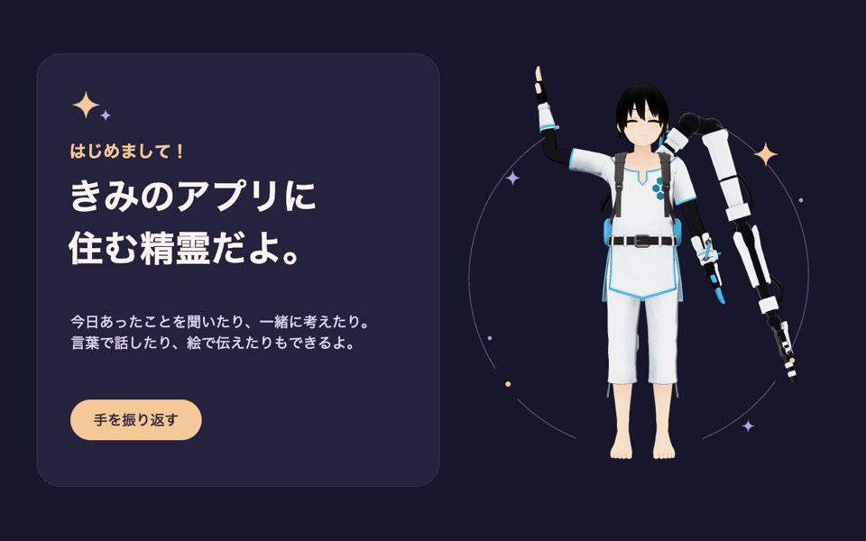 |
| 見本（モデルなし）。左は VRM（`wave`、`happy`）、右上は写真と動画、太陽は回転、顔は 2 コマのパラパラ、丸は跳ねる | 自己紹介。spirit が組んだもの（VRM は `framing: full`） |
| 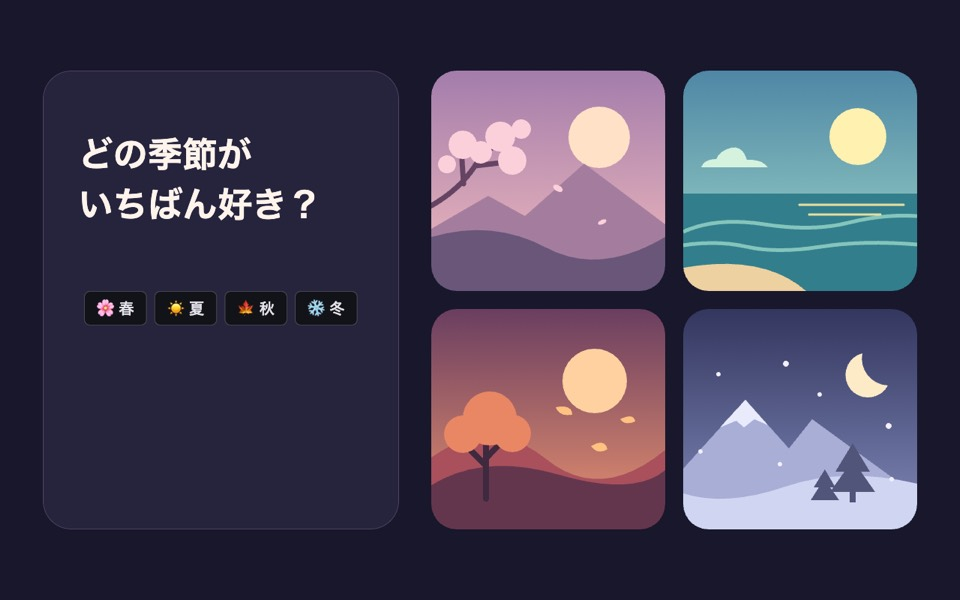 |  |
| 「好きな季節を選択肢で聞いて」。4 枚の絵は SVG で spirit が描いた | 手元の写真・動画・音声で「街の一日」。朝・午後・夜の切り替えと再生はボタン |

## How it works

```text
app/lib/
  main.dart               画面（チャット / キャンバスの切り替え、入力欄、字幕）、道具の実行、イベントを spirit へ
  spirit.dart             codex app-server の thread 1 本（dynamicTools、code mode を切ったモデル表）
  spirit_tools.dart       道具の定義（JSON Schema）と spirit への指示
  canvas/canvas_model.dart  要素・アニメ（キーフレーム）・イベント
  canvas/canvas_view.dart   1280x800 の舞台を窓に合わせて縮める。要素ごとの描画、撮影
  canvas/vrm_element.dart   VRM（flutter_vrm）。ポーズ・表情・.vrma・構図・口パク
  control_server.dart     検証用のローカルの HTTP（送る・モード・イベント・撮影・状態）
  demo_scene.dart         モデルを使わない見本
drive.py / wait_turn.py   検証の操作と記録
```

### 道具

| 道具 | すること |
| --- | --- |
| `canvas_view(image?)` | 今のキャンバスを画像と要素の一覧で見る。ユーザーがどちらのモードかも返す |
| `canvas_put(elements[])` | 要素を置く（同じ id は置き換え）。1 回で画面全体を置ける |
| `canvas_update(id, props, transition_ms?, easing?)` | 一部の属性を変える。`transition_ms` で位置・大きさ・透明度などをなめらかに動かす |
| `canvas_animate(id, keyframes[], duration_ms, repeat, alternate, easing)` | キーフレームのアニメ。アプリが再生し、spirit はフレームごとに呼ばない |
| `canvas_remove(ids)` / `canvas_clear(background?)` | 消す |
| `canvas_media()` | 見せてよい写真・動画・音声・VRM・VRMA の名前 |

要素の種類は `text`・`shape`・`image`・`svg`（`frames` でパラパラ）・`video`・`audio`・`vrm`・`button`・`choices`・`input`。
すべて `id`・`x`・`y`・`w`・`h` を持ち、`z`・`opacity`・`scale`・`rotation`・`tappable` が共通です。属性の一覧は `spirit_tools.dart` の `_elementSchema`。

ユーザーの操作は `press`（ボタン）・`choose`（選択肢）・`submit`（入力欄）・`tap`（`tappable` の要素）・`ended`（動画・音声の終わり）で、
250 ms 以内のものをまとめて 1 通にし、`<canvas_event event="press" id="..."/>` の形で送ります。spirit の turn が動いていれば `turn/steer` で差し込みます。
ユーザーのメッセージにも毎回 `<ui mode="canvas"/>` を付けて、今どちらを見ているかを渡します。spirit の普通の返事は、キャンバスの下に字幕として出ます。

キャンバスの大きさは 1280x800 の固定で、窓に合わせて縮めます（spirit がいつも同じ座標で置けるように）。チャットのモードの間もキャンバスは描かれ続けます（spirit が見られるように）。

### Codex の設定

[司令塔の lab](../../../10/06/flutter-agent-orchestrator/README.md) と同じく、道具は `thread/start` の `dynamicTools`（`experimentalApi`）。
[API のように使う lab](../../../10/07/agent-runtimes-as-llm-api/README.md) で見つけた code mode を、`~/.codex/models_cache.json` を写して `tool_mode` などを null にしたモデル表（`model_catalog_json`）で切ります。
code mode のままだと道具の結果が 1 つの文字列になり、`canvas_view` の画像が画像として届きません。シェル・Computer Use・ブラウザなどの機能は thread ごとに切っています。

## Results

条件: MacBook Pro（M1 Max、macOS）、Flutter 3.47.2（Dart 3.13.2）、Codex CLI 0.172.0、`gpt-6.2-sol`（推論 effort は既定の low）、
ChatGPT のサブスクで実行。各シナリオ 1 回ずつ（ばらつきは見ていない）。

1 本の thread で続けて流した（s1〜s7）。トークンは累計の差分。「道具」の括弧内は `canvas_view` の回数。

| シナリオ | 時間 (s) | 最初の道具まで (s) | 道具 | 入力 | うちキャッシュ | 出力 |
| --- | ---: | ---: | --- | ---: | ---: | ---: |
| s1 自己紹介して | 56 | 4 | 10 (5) | 139,692 | 108,672 | 1,635 |
| s2 「手を振り返す」を押す（画面で実際にクリック） | 10 | 3 | 2 (0) | 51,124 | 50,432 | 177 |
| s3 好きな季節を選択肢で聞いて、答えたら絵を | 57 | 6 | 5 (2) | 121,399 | 113,536 | 2,325 |
| s4 「秋」を選ぶ（画面で実際にクリック） | 240 | 21 | 12 (2) | 435,461 | 395,264 | 10,773 |
| s5 写真・動画・音声で「街の一日」 | 116 | 3 | 10 (3) | 589,465 | 578,432 | 4,150 |
| s6 チャットのモードで朝ごはんの相談 | 6 | — | 0 | 59,007 | 58,624 | 166 |
| s7 チャットのまま「それ、絵で見てみたいな」 | 121 | 20 | 3 (1) | 253,026 | 242,176 | 5,339 |

`canvas_view` が長い SVG（300 文字を超える `markup`・`frames`）を長さだけ返すようにして、新しい thread で s3・s4 を流し直した:

| シナリオ | 時間 (s) | 最初の道具まで (s) | 道具 | 入力 | うちキャッシュ | 出力 |
| --- | ---: | ---: | --- | ---: | ---: | ---: |
| v2-s3 好きな季節を…（同じ文） | 49 | 4 | 3 (2) | 41,978 | 29,056 | 2,043 |
| v2-s4 「秋」を押す | 168 | 12 | 8 (1) | 178,919 | 167,168 | 7,845 |

- v2-s4 の差分には、間に挟まった空のイベントの 1 ターン（下の「失敗した試行」、入力 12,605）を含む
- v2 では spirit が選択肢ではなく 4 つのボタンで季節を聞いた。描いた絵も別物（[v2-s3](results/v2-s3-ask.jpg)、[v2-s4](results/v2-s4-choose.jpg)）で、比べは「同じ依頼で入力がどれだけ減ったか」の目安にとどまる
- 各ターンの記録（道具の引数・結果の先頭、要素の一覧）は `results/*.json`。長い文字列は 2,000 文字を超えると切ってある

### 観測したこと

- spirit は `canvas_view` で自分の画面を見て直した（s1 で 5 回）。直したのは位置・大きさ・VRM の構図で、文字のはみ出しはどのシナリオでも起きなかった
- s4 で spirit は、最初に 1 枚の SVG で背景を描き、葉を別の要素にして `canvas_animate` を 6 回、川面の光に 1 回呼んだ。そのあと見て、木の葉の層を別の SVG で足した
- 字幕として出る spirit の最初の一言（「キャンバスで、手を振ってごあいさつするね。」）は道具の前に出るので、待っている間の手がかりになった
- s5 の「朝・午後・夜」の切り替えボタンは、押すたびに spirit への往復になる作り（spirit が押されたら `canvas_update` で動画を替える前提）。押したときの反応は s2 から見て 10 秒前後になるはず（押していない）
- s7 で spirit はチャットのモードのまま描き、`canvas_view` の `mode: chat` を見て「切り替えると見える」と書いた。モードを切り替える道具は無い

### 失敗した試行・都合の悪い結果

- **VRM が背中を向けた。** 最初の版の `framing: full` は、カメラを +Z に置いていた。flutter_vrm の `VrmPortrait.bust` が返す向きを使うように直した。直す前の s1 で、spirit は撮影を 5 回見たが背中であることには触れず、そのまま「はじめまして」と返した
- **検証のスクリプトの誤り:** v2 で選択肢を探すスクリプトが、ボタンで聞かれたため空の `choose` イベントを送った。spirit は「季節がまだ選ばれていないみたい」と返した（5 秒）。そのあと「秋」のボタンを押し直した
- **2 回目以降のビルドが Xcode で失敗した。** `Cycle in dependencies between targets 'Runner' and 'Flutter Assemble'`。`build/macos` だけを消しても直らず、`flutter clean` からなら通った。
  そこで設定を `--dart-define` から環境変数に変え、`mise run build`（clean から）と `mise run run`（ビルド済みのアプリを環境変数付きで起動）に分けた
- `codex app-server` の既定のモデルは `gpt-6.2-astra` だった。この lab では `MODEL` の既定を `gpt-6.2-sol` にしている

## Part 2: spirit を通さずにアプリだけで動かす

Part 1 では、押すたびに spirit を往復した（ボタン 1 回で約 10 秒）。spirit が考えるのは組み立てるときだけにし、動かすのはアプリに任せる仕組みを足した。

### 足したもの

| | すること |
| --- | --- |
| 要素の `on` | 押した・選んだ・入れた・タップ・終わったときに、アプリがその場で動作の列を行う（`update`・`animate`・`put`・`remove`・`set`・`add`・`timeline`・`notify`）。`choose` は値ごとに分けられ、`$value` で値を差し込める |
| 要素の `notify` | ユーザーの操作をどう spirit に伝えるか。`now`（起こす）・`later`（次に話すときにまとめて渡す）・`none`。既定は、キャンバスの上で誰も扱わなければ `now`、`on` かスクリプトが扱えば `later` |
| 状態と `{{name}}` | 共有の値。文字・ボタンの文字の `{{name}}` に差し込まれ、値が変わるとすぐ表示も変わる。spirit は `canvas_state` で一部だけ書き換えられる |
| `canvas_timeline` | 時刻ごとの動作の列。繰り返し・1 周の長さを指定できる |
| `canvas_script` | spirit が書く JavaScript を、アプリの中で動かす。`sg.every`・`sg.after`・`sg.on`（操作・状態）・`sg.set`・`sg.update`・`sg.put`・`sg.animate`・`sg.notify(text, {wake})` |
| 通知 | 後回しの通知（`<canvas_notice>`、`handled` の付いた `<canvas_event>`）は、次に spirit へ送るメッセージの先頭にまとめて付く。起こす通知は 5 秒に 1 回までに間引き、間のものはまとめて送る |

スクリプトは、`flutter_js` 0.8.7 の 1 つの JavaScript の文脈（macOS では JavaScriptCore）で、fetch・XHR を入れずに動かす。
タイマーは JavaScript 側に持ち、アプリが 50 ms ごとに `__sg.tick` を呼ぶ。スクリプトからアプリへは `sendMessage` で、値を同期で返す。
ハンドラの中の例外は spirit への通知になり、3 回落ちたスクリプトは止める。読み込みの時点の構文エラーは道具の結果で返る。

**安全の範囲（lab の時点）:** ネットワーク・ファイル・DOM は無い。ただし、無限ループは止められない（UI と同じスレッドで同期に動くため、アプリが固まる）。製品にするなら、別の isolate かプロセスと実行時間の上限が要る。

### モデルなしの確認

`/tool` で道具を直に呼んで確かめた（`results/behaviors-demo.jpg`）: 毎秒進む時計（スクリプトが `sg.set`、文字は `{{time}}`）、`on` で数える回数と星のアニメ、0.7 秒ごとのスライドのタイムライン、
3 の倍数でスクリプトが後回しの通知を残す、構文エラーが道具の結果で返る、毎回落ちるスクリプトが 3 回で止まり通知は 2 件だけ残る。単体テスト（`test/behaviors_test.dart`）で `on`・`choose` の振り分け・テンプレート・タイムライン・通知の間引きを見ている。

### gpt-6.2-sol に流した結果

新しい thread で、b1〜b4 を続けて流した。

| シナリオ | 時間 (s) | 最初の道具まで (s) | 道具 | 入力 | うちキャッシュ | 出力 |
| --- | ---: | ---: | --- | ---: | ---: | ---: |
| b1 地理クイズを 3 問、答えたらその場で正誤と点数 | 69 | 14 | clear, put, script, view | 60,822 | 32,384 | 2,868 |
| b1 を解いた後「終わったよ！どうだった？」 | 31 | 5 | view, put, view | 68,858 | 61,184 | 1,160 |
| b2 1 分のタイマーと時刻、スタートボタン、終わったら声をかけて | 50 | 11 | media, clear, put, script, view | 127,650 | 122,624 | 2,066 |
| b2 のタイマーが終わってスクリプトが spirit を起こした | 2 | — | — | 23,444 | 23,040 | 21 |
| b3「タイマーは 3 分、時刻はオレンジに。ほかはそのまま」 | 24 | 20 | script, view | 73,016 | 62,208 | 982 |
| b4 自己紹介を 3 枚のスライドで 4 秒ごと、最後に「もう一度」 | 79 | 11 | view, clear, put, view, script, view | 198,340 | 184,704 | 3,365 |

| | |
| --- | --- |
| 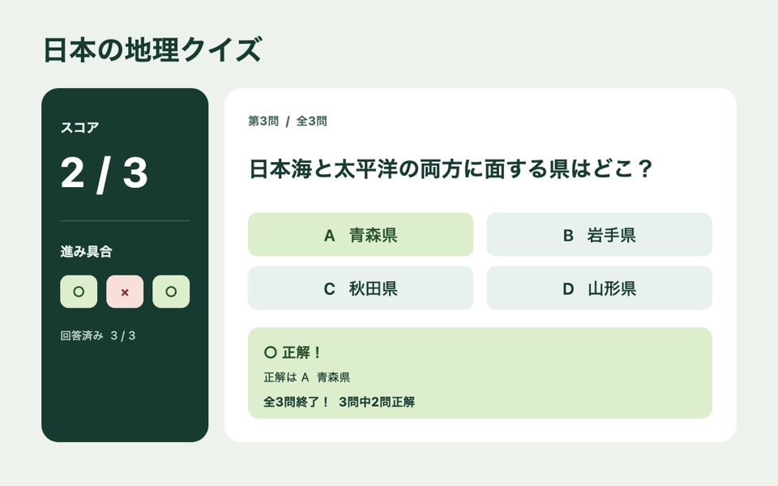 |  |
| b1 を 3 問解いた後。答え合わせ・点数・進み具合・次へはすべてスクリプト | b2 の集中タイム |

spirit が書いたスクリプトは `results/scripts/`（46〜61 行）。

- **押したときの反応が、spirit の往復なしになった。** クイズの選択・次へを 5 回押し、押してから画面の値が変わるまで 4〜9 ms（制御のポートから押して状態を読むまで。描画の時間は含まない）。その間 spirit は一度も起きなかった
- **時間で spirit を起こせた。** タイマーのスタートを画面で実際にクリックし、ちょうど 1 分後にスクリプトが `sg.notify(..., {wake: true})` で起こした。spirit は道具を使わず 2.5 秒で「1分経ったよ。集中タイム終了、おつかれさま！」と返した
- **Sol は 4 つとも JavaScript のスクリプトで作った。** `on`・`canvas_timeline`・`canvas_state` は一度も使わなかった。スライドショー（b4）もタイムラインではなくスクリプトだった
- **spirit は答えのボタンに自分で `notify: "none"` を付けた。** 押されたことを自分に知らせない選択で、「どうだった？」と聞かれると `canvas_view` で画面を読み、「3問中2問正解、第2問の正解は琵琶湖」と答えた（31 秒）
- **「ほかはそのまま」の部分の変更（b3）は、スクリプトの丸ごとの書き直しになった。** タイマーの長さと時刻の色をスクリプトの中に持っていたため。画面は作り直さず 24 秒で済んだが、長さを状態に出していれば `canvas_state` の 1 回で済んだはず（解釈）
- 「終わったら教えて」（b1）は、spirit を起こすのではなく、画面に「全3問終了！ 3問中2問正解」を出す形にした
- スライドは約 4 秒ごとに切り替わり、最後のスライドでだけ出る「もう一度」で最初に戻った。表示中に押しても何も起きない作り

## Part 3: 作り置きの画面と音

使ってみたオーナーから、spirit の字幕が出続けて邪魔だったことと、作っておいた画面をすぐ流したい、音や BGM を鳴らし・変えたい、という声があった。

### 足したもの

| | すること |
| --- | --- |
| 字幕 | 流れてくる間と、読み終える程度の時間（4 秒 + 1 秒に 8 文字）だけ出して消える。キャンバスに触ると消える |
| `canvas_save` | 画面を丸ごと 1 つの JSON に保存する（要素・背景・状態・タイムライン・スクリプトの元のコード・BGM）。`params` に、呼び出すときに差し替える状態の名前と説明を書く |
| `canvas_load` | 保存した画面を、`values` で params を差し替えて一度に出す |
| `canvas_scenes` | 作り置き（lab の `scenes/`、Git に入る）と spirit が保存したもの（`work/scenes/`）の一覧。名前・説明・params だけ |
| `canvas_audio`、動作の `sound`・`bgm`、`sg.sound`・`sg.bgm` | 効果音を 1 回鳴らす。BGM は 1 本で、曲を替えるとクロスフェード、同じ曲なら音量だけ動かす、`stop` でフェードアウト |
| 音の素材 | `make_sounds.py` が標準ライブラリだけで合成する（効果音 7 個、8 小節の BGM 3 曲）。ライセンスの要る素材は使わず、生成物は Git に入れない |

指示には「作る前に `canvas_scenes` を見て、合うものがあれば値を差し替えて呼び出す」「使い回せそうな画面は、変わりうる値を状態に出してから保存する」を足した。

### 結果

| シナリオ | 時間 (s) | 最初の道具まで (s) | 道具 | 入力 | うちキャッシュ | 出力 |
| --- | ---: | ---: | ---: | ---: | ---: | ---: |
| c1 中1数学の宇宙基地からの脱出ゲーム、5 問、BGM と効果音つき、別の教科でも使えるよう保存して | 276 | 5 | 17 | 454,601 | 416,000 | 11,577 |
| c2 （アプリを起動し直した新しい thread で）「宇宙基地からの脱出ゲーム、今度は中学1年の英語でやりたい」 | 39 | 4 | 4 | 67,594 | 38,784 | 1,415 |

| | |
| --- | --- |
| 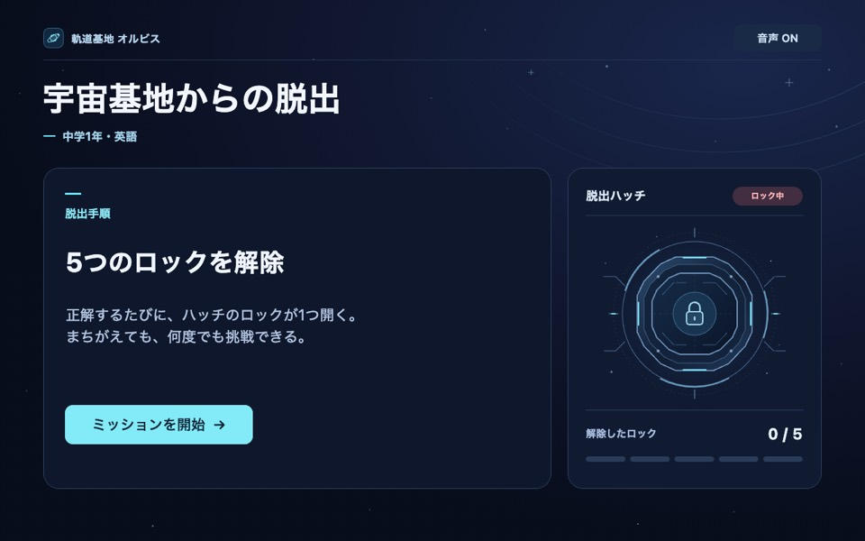 |  |
| c2 で呼び出した英語版の開始画面（数学版と同じ作り） | 1 問目を間違えたところ |
| 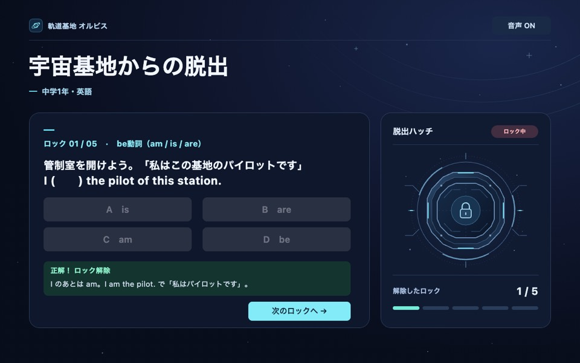 | |
| 正解すると 1 つ目のロックが外れる | |

- **作り置きを呼び出すと、7 分の 1 の時間になった。** c2 は `canvas_scenes` → `canvas_load`（英語の 5 問を `values` で渡す）だけで、出力は 1,415 トークン。ゼロから作った c1 は 276 秒・出力 11,577 トークン
- **Sol は使い回すつもりの画面を、状態から描く作りにした。** 題名・教科・問題（問い・選択肢・答え・ヒント・解説）を状態に置き、6,278 文字のスクリプトがそこから描く。`params` は `gameTitle`・`subject`・`questions`。保存したあと、理科の 2 問で試しに呼び出して確かめ、数学に戻した
- c2 では、一度呼び出して `canvas_view` で見たあと、問題の文を短く直してもう一度呼び出した
- 呼び出し（`canvas_load`）は 15〜36 ms。保存したファイルは 22,238 バイト（要素 35、スクリプト 1）。[`scenes/space-station-escape.json`](scenes/space-station-escape.json) に作り置きとして入れた
- 効果音・BGM は、モデルなしで鳴らし・替え・止めて、エラーが出ないことと BGM の状態（曲・音量）を見た。耳で聞いての確かめは、この記録の時点ではしていない

### 失敗した試行

- **呼び出した英語版で、押しても画面が変わらなかった。** Sol のスクリプトは、自分の `sg.set` の後に `sg.on("state")` の描画が走る前提で書かれていた。こちらの実装は、spirit（`canvas_state`）と動作（`set`）からの変更でしか状態のハンドラを呼んでいなかった。
  道具の説明もそこをはっきり書いていなかった。スクリプトの `sg.set` の後も、ハンドラが返ってから状態のハンドラを呼ぶように直した（1 回の流れで 3 回まで）。直した後、同じ `values` で呼び出し、不正解→ヒント、正解→ロック 1/5 まで画面と音が動いた。
  c1 の中で Sol が試した呼び出しは、spirit 側から `canvas_state` で状態を動かして確かめていたので、この不具合に当たらなかった

## Part 4: web 要素（WebView）

オーナーの問い: WebView の中の画像や素材を `asset://` で指定して差し込めるか、中の JS のイベントを外で受けて spirit に届けられるか、途中の状態を spirit が外から取れるか。Windows・Mac・Android・iOS に対応しているか。

### 作り

| | どうしたか |
| --- | --- |
| WebView | `webview_flutter` 4.14（公式。macOS・iOS は WKWebView、Android は Android WebView）。要素の型 `web` に `html`（または https の `url`） |
| `asset://` | アプリの中に、ループバックだけの小さな HTTP サーバーを立てる。ページはそこから配り、HTML の `asset://<名前>` を `http://127.0.0.1:<port>/asset/<名前>` に書き換える。ページが後から足す要素（`src`・`href`・`poster`・`style`・`<style>`・`fetch`・`new Audio`）は、先頭に差し込む小さな JS が書き換える。WebView の独自スキームの仕組みに頼らないので、WebView の種類を選ばない |
| JS → 外 | ページの `sg.emit(name, data, {wake})` が JavaScript channel（`SGHost`）でアプリに届き、`event="web"` のイベントとして spirit へ。`wake` で、すぐ起こすか次にまとめて渡すかをページが決める。`on`・スクリプトの `sg.on("web")` でも受けられる |
| 外から状態 | ページの `sg.setState(obj)` をアプリが持ち、`canvas_view` の `web` に入れる（JS を走らせずに読める）。加えて `canvas_web_eval(id, js)` でページの中の JS を走らせて値を受け取る。`canvas_view` はページの本文（`innerText` の先頭 800 文字）も返す |

### モデルなしの確認

1 つのページ（[`results/web-test-page.json`](results/web-test-page.json) を `/tool?name=canvas_put` に渡した）で:

- **`asset://` の差し込み:** `` は 1254 px で読めた。CSS の `url(asset://…)` は `url("http://127.0.0.1:…/asset/…")` になった。押すたびに JS が `img.src = 'asset://…'` で足した画像も 1536 px で読めた
- **JS → 外:** ページのボタンを 2 回押すと、`sg.emit('pressed', {count}, {wake: false})` が 2 件、次に spirit へ渡す通知として積まれた
- **外から状態:** `canvas_web_eval` で `window.secret()` が「inner 2」を返した。`canvas_view` の `web` に `{"state": {"count": 2}, "text": "…押した回数: 2…"}` が入った
- **ページの中の音:** 最初は `new Audio('asset://…').play()` が `NotSupportedError` で失敗した。WebKit が利用者の操作なしの再生を止める設定を外しても同じだった。原因は配信の側で、WebKit は音声・動画を部分取得（HTTP の Range）で読む。サーバーが 206 で返すようにすると鳴った（`played ok`）

### gpt-6.2-sol に流した結果

w1「web ブロックで、20秒のもぐらたたきゲームを作って。手元の効果音とBGMを使って。途中で様子を見て応援してくれて、終わったら結果について話しかけてね」

| | 時間 (s) | 道具 | 入力 | うちキャッシュ | 出力 |
| --- | ---: | --- | ---: | ---: | ---: |
| 作る（新しい thread） | 308 | 22（うち `canvas_web_eval` 11） | 550,072 | 486,272 | 13,462 |
| 10 秒の時点でページが起こした | 4 | 0 | 29,960 | 29,568 | 117 |
| 終わってページが起こした | 2 | 0 | 30,208 | 29,056 | 45 |


- Sol は 20,130 文字の HTML を 1 つの `web` 要素に書き、`asset://sounds/…` で BGM と効果音を鳴らした。10 秒と 20 秒に `sg.emit(…, {wake: true})` を置き、`sg.setState` で得点などを外に出した
- **Sol は `canvas_web_eval` でページの中に試験用の仕組みを差し込み、10 秒の応援と 20 秒の終わりまで自分で通しの試験をした。** そのうえで、ゲームの秒数を状態に出して `mole-garden` として保存した（[`scenes/mole-garden.json`](scenes/mole-garden.json)）
- 遊んだとき: スタートと、もぐらを叩く操作は、こちらが `canvas_web_eval` でページのボタンを押した（窓が後ろにあるとき、コンピューター操作のクリックが WebView の中に届かなかった）。10 秒の時点で spirit が起きて 4 秒後に「折り返しで16匹、ここまで全部命中！ あと10秒、その調子！」、終わりで 2 秒後に「20秒で32匹！ 出てきた33匹のうち、逃したのはたった1匹。…最後までいいペースだったね！」と言った（32 匹は JS で叩いた数）

### 分かった制約

- **spirit に見せる撮影（`RepaintBoundary`）に WebView は写らない。** プラットフォームのビューなので。代わりに `canvas_view` は本文と `sg.setState` の状態を返す（macOS は Part 6 で、WebView の絵を重ねて撮るようにした）。Sol は `getBoundingClientRect` などを `canvas_web_eval` で読んで配置を確かめていた
- macOS の WebView は透明な背景に対応していない（`setBackgroundColor` が `UnimplementedError: opaque`）。ページが自分の背景を塗る
- **WebView は、キャンバスのほかの要素より常に上に出る。** 縮める枠の外に置いているため（下の不具合の直し）。`opacity`・`scale`・`rotation` も WebView には効かない（位置と大きさのアニメは効く）

### 操作の速さ: もぐらと「音あり」が遅い

オーナーが試すと、もぐらを叩いたときと「音あり」を押したときの反応が、「もう一回」より遅く感じた。Sol が書いたページの作りが原因だった。

- もぐらは `click` で受けていた。`click` は離したときに起きるので、押してから離すまでの分だけ遅れる。「もう一回」は普通のボタンなので、離して反応しても自然に感じる
- 効果音を `<audio>` で鳴らし、1 つの要素の `src` をクリック音とファンファーレで差し替えて使い回していた。差し替えるたびに読み直しになり、鳴り始めるまで 56〜171 ms（3 回）。差し替えのないもぐらの音は、再生の開始の通知までは 0〜1 ms（出力までの遅れはページの中からは測れない）
- 同じページで Web Audio を試すと、出力の遅れ（`outputLatency`）は 16 ms

作り置き（`scenes/mole-garden.json`。オーナーの試用中に spirit が手直しした版）を、もぐらは `pointerdown` で叩く、効果音は先に展開した Web Audio で鳴らす、に直した。
直した後、3 つの効果音が展開され（pop 80 ms・click 30 ms・fanfare 720 ms の長さ）、スタート・叩く・「音あり」の効果音が Web Audio、BGM だけが `<audio>` で鳴り、`pointerdown` で得点が 0 → 1 になった。
spirit への `web` の説明にも「すぐ反応させたいものは `pointerdown`、効果音は先に展開した Web Audio、`<audio>` は音楽に」を足した（足した後の Sol での確かめはしていない）。

ここまでの WebView の知見は、ほかの lab でも使えるよう [`docs/flutter-webview.md`](../../../../docs/flutter-webview.md) にまとめた。

### 失敗した試行: WebView の中のボタンが押せなかった

オーナーが試すと、Sol が作ったもぐらたたきの「もう一回」をクリックしても反応しなかった。
最初の版は、WebView もほかの要素と同じく 1280x800 の舞台に置き、舞台ごと `FittedBox` で窓に合わせて縮めていた。
見た目は縮んで描かれるが、WebView のネイティブのビューは縮める前の大きさのままで、クリックは縮める前の位置として届いていた。
窓の (400, 400) のクリックがページの (398, 323) に届いた（見た目どおりなら、およそ (663, 538)）。アクセシビリティの座標も見た目とずれていた。
Sol の自己試験や `canvas_web_eval` での操作は JS からボタンを押していたので、この不具合に当たらなかった。

直し方: WebView だけを舞台の外に出し、窓の上の実際の位置と大きさ（舞台の座標 × 縮みの割合）で置く。ページは同じ割合の CSS `zoom` で縮め、ページの中の CSS の画素は舞台の座標のままにする（ページの URL の `zoom` と `sg.setZoom`）。
直した後、右下 4 分の 1 に置いたページのボタンを見た目の位置でクリックすると、ボタンの上に届いて押された。もぐらたたきのスタートも、画面のクリックで始まった。アクセシビリティの座標も見た目と合った。

### 対応する OS

| OS | WebView | この lab での状態 |
| --- | --- | --- |
| macOS | `webview_flutter`（WKWebView） | 確かめた |
| iOS | 同じ（WKWebView） | 未確認。同じ実装で動く見込み |
| Android | 同じ（Android WebView） | 未確認。自動再生の扱いは別の設定が要る可能性 |
| Windows | `webview_flutter` は非対応。API 互換の `webview_all`（2026-11 の版、WebView2）か、2024 年で止まっている `webview_windows` | 未確認 |

使っているのは、ページの読み込み・JavaScript channel・JS を走らせて結果を受け取る、の 3 つだけ。`asset://` は WebView の独自スキームではなくループバックのサーバーで解くので、Windows でも WebView の差し替えで済む見込み（解釈。動かしていない）。

## Part 5: 画面の大きさに合わせる

ここまでのキャンバスは 1280x800 の固定で、窓に合わせて縮めていた。スマートフォンの縦の画面ではとても小さくなるので、他の OS で確かめる前に、端末の大きさに合わせる形にした。

### 作り

| | すること |
| --- | --- |
| キャンバスの大きさ | 端末で実際に使える大きさ（論理ピクセル）。毎回のメッセージの `<ui canvas="430x758" orientation="portrait">` と `canvas_view` で spirit に渡す |
| 位置と大きさ | `x`・`y`・`w`・`h` は px のほか `"N%"`（x と w は幅、y と h は高さに対して）。`anchor`（`center`・`bottom-right` など 9 か所）で、x, y をどこから測るかを決める（キャンバスと要素の同じ点を合わせる） |
| 決まった大きさで作る画面 | `canvas_clear` の `design: {width, height}` で、その大きさで描いて窓に合わせて縮める（今までの形）。保存した画面にも `design` が入る。`design` を持たない古い作り置き（脱出ゲーム・もぐらたたき）は 1280x800 として呼び出す |
| 大きさが変わったら | スクリプトは `sg.width`・`sg.height` がすぐ変わり、`sg.on("resize", "canvas", fn)` が呼ばれる。spirit には、大きさが 0.7 秒落ち着いてから、向きが変わったか面積が 4 分の 1 以上変わったら起こし（`<canvas_event event="resize">`）、それより小さければ次のメッセージにまとめて渡す |
| アニメ | `%` や `anchor` で置いた要素は、アニメが終わると、置き方の位置に戻る（数字だけで置いた要素は、今までどおり最後の位置に留まる） |
| 撮影 | spirit に見せる画像は長い辺 960 px まで（小さい画面はそのまま） |
| WebView | 縮めないときは CSS の `zoom` も 1。ページが自分の CSS で幅に合わせる |

指示には「キャンバスは利用者の画面（広い窓のことも、縦に持ったスマートフォンのこともある）。`<ui>` の大きさで組み、`%` と `anchor` で大きさが変わっても崩れないように。向きが変わったら起こされるので、合わなくなったところを直す」を足した。

### 確かめたこと

- モデルなし: 見出し（`anchor: top`、幅 90%）・中央のカード（`center`、80%×40%）・右下の OK ボタン（`bottom-right`、-16, -16）を置き、窓を 430×900 と 1200×800 に変えた。キャンバスは 430x758（縦）と 1200x658（横）になり、3 つとも置き方どおりに追従した
- 単体テスト: `%` と `anchor` の位置、大きさの変化の通知、`design` の縮み、置き方に戻るアニメ
- 起動直後の最初の配置まで「大きさが変わった」と数えて spirit を起こしていたので、最初の 1 回は数えないように直した
- Sol: 窓の向きを変えると spirit が起き、`canvas_view` で見て「横向きの画面で、見出し・カード・OKボタンが重ならずに表示されているよ」と返した（8 秒）
- Sol: 縦の窓（430x766）で「今日の予定を確認できる画面を作って…終わったらチェックできるようにして」と頼むと、画面全体（`100%`×`100%`）の web 要素 1 つを CSS で組み、予定を状態に出して `today-planner` として保存した（99 秒）。アプリを起動し直した別の会話で同じ文を送ると、それを呼び出して 23 秒で出した

| | |
| --- | --- |
| 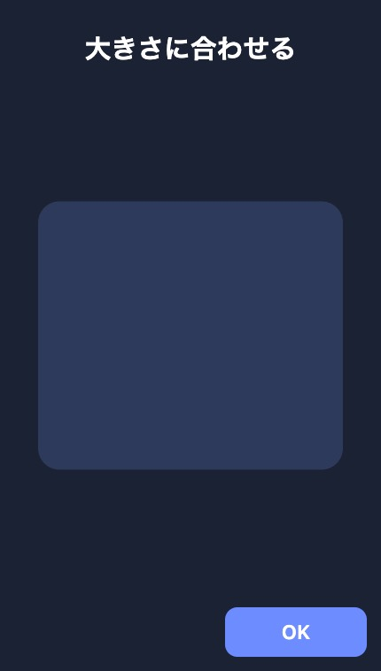 | 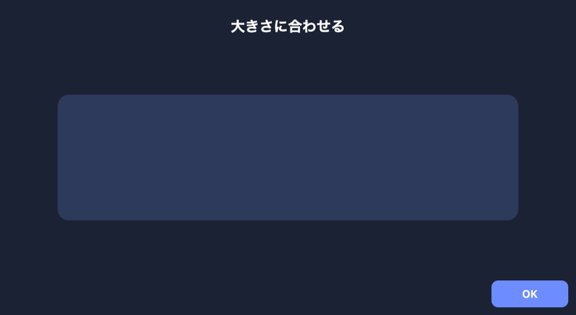 |
| 430x758 | 1200x658（同じ要素のまま） |

### 確かめられなかったこと

- 縦の窓で作った予定の画面の見た目は、こちらでは撮れなかった。後ろにある窓の WebView は描画が止まり、窓の撮影では黒く写った（アプリの中の撮影には WebView は写らない）。中身は `canvas_view` の本文で確かめた
- その後、窓を横に変える操作（System Events）が窓を取れずに失敗し、横向きにしたときに spirit が予定の画面をどう直すかは見ていない

## Part 6: WebView も spirit に見せる撮影に入れる

Flutter の撮影（`RepaintBoundary.toImage`）にはプラットフォームのビューが写らないので、spirit には WebView の本文と状態だけを渡していた。
各ページの絵を WebView 自身に撮らせ、舞台の撮影の同じ場所に重ねて 1 枚にした（macOS）。

- `webview_flutter_wkwebview` の公開の口で、ページの裏の WKWebView を取り出す（Dart の `WebKitWebViewController.webViewIdentifier` と、Swift の `FWFWebViewFlutterWKWebViewExternalAPI.webView(forIdentifier:withPluginRegistry:)`）
- アプリの Swift（`macos/Runner/MainFlutterWindow.swift`）に MethodChannel `spirit_canvas/webview` を足し、`WKWebView.takeSnapshot` の PNG を返す
- Dart で、舞台の画像の上に、各 web 要素の位置（キャンバスの座標 × 撮影の倍率）へページの画像を描いて 1 枚にする。撮れなかったページは、理由を `canvas_view` の文に添える

| | | |
| --- | --- | --- |
|  | 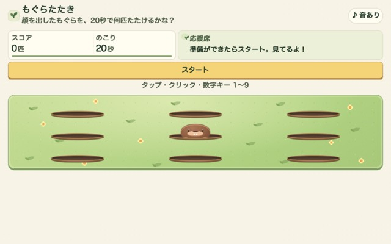 | 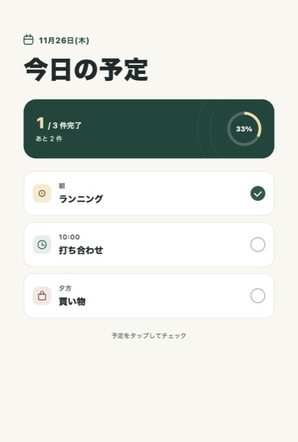 |
| 全面の WebView（525x777） | 固定の大きさ（1280x800）を縮めた WebView | 窓をしまったまま、ページの中で 1 件目にチェックを入れて撮った |

- **窓が後ろにあっても、しまってあっても撮れた。** しまった窓で、ページの中の 1 件目にチェックを入れると、その後の状態（1/3、33%）が 0.6 秒で撮れた。窓の撮影（OS の機能）では、後ろの窓の WebView は黒く写ったが、`takeSnapshot` はページを描き直して撮る
- **窓をしまうと、Flutter はフレームを描かない。** 呼び出しと撮影の中で「次のフレームを待つ」処理が終わらず、道具が返らなくなった。待ちを 500 ms までにした。しまったまま新しく置いた要素は、窓を戻すまで作られない（WebView も作られないので撮れない。その理由を返す）。舞台の画像は、描かれていない変更があると撮れないことがある（理由を返す）
- **固定の大きさの画面を縦長の窓で見ると、WebView の中の CSS の `@media` は窓の幅で効く。** もぐらたたきは 1280x800 で作られているが、525 px の窓では縮めた WebView の幅が 525 px になり、ページの狭い画面向けの組み方に変わった。`zoom` ではページから見える幅は変わらない
- spirit の操作（作り置きの呼び出しや `design` の指定）で大きさが変わったときは、spirit を起こさないようにした（起動直後に、作り置きを呼び出しただけで「大きさが変わった」と起こしていた）

Android・iOS・Windows は未対応。Android は同じく公開の口（`AndroidWebViewController.webViewIdentifier` と `WebViewFlutterAndroidExternalApi`）で WebView を画像に描ける見込み、Windows の WebView2 には `CapturePreview` がある（どちらも未確認）。

## Part 7: iOS と Android で確かめる

スマートフォンでは Codex を起動できないので、spirit はつながない。画面の側（描画・VRM・動画・音・スクリプト・WebView・撮影・画面の大きさ・作り置きの呼び出し）を、
制御のポートから道具を直に呼んで確かめた（`check_device.py`。結果は `results/device-ios.json`・`results/device-android.json`）。

- iOS: iPhone 18 Pro Max の Simulator（iOS 27.2）。`mise run run-ios`（`flutter run`。Simulator は Mac のファイルをそのまま読む）
- Android: Pixel 6（実機、ワイヤレスデバッグ。表示密度は 460 に上書きされていた）。`mise run run-android`（素材をアプリの内側の保存先へ `run-as` で写し、ポートを `adb forward`）

| 確かめたこと | iOS | Android |
| --- | --- | --- |
| 見本（VRM・写真・動画・SVG・選択肢・入力欄・音声）、1280x800 を縮めて | 描けた | 描けた |
| キャンバスの大きさ・`%`・`anchor` | 440x734（縦）で置き方どおり | 376x640（縦）で置き方どおり |
| スクリプト（JS）・状態と `{{}}`・タイムライン・`on`・効果音・BGM | 動いた（JavaScriptCore） | 動いた（QuickJS） |
| WebView: `asset://`（HTML・CSS・後から足した画像）、イベント、状態、`canvas_web_eval` | 動いた | 動いた |
| WebView の中の音（`new Audio('asset://…')`） | 鳴った | 鳴った（Android の「タップしてから再生」を外して） |
| WebView の撮影を spirit に見せる画像へ重ねる | 重なった（`takeSnapshot`。Swift は AppDelegate） | 重なった（`WebView.draw` で Bitmap に。Kotlin は MainActivity）。アプリが裏にある間は古い絵になる |
| 作り置きの呼び出し（脱出ゲーム・もぐらたたき・予定） | 2〜19 ms | 6〜73 ms |
| 画面の実際のタップが WebView に届く | 予定の 2 件目にチェック、もぐらたたきのスタート | 同じ（`adb shell input tap`） |

| | | |
| --- | --- | --- |
| 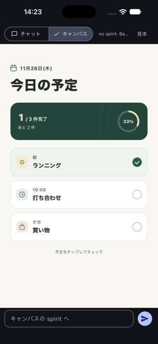 | 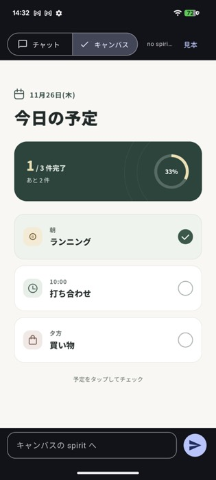 | 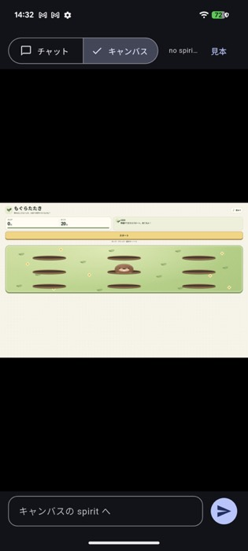 |
| iOS Simulator | Pixel 6 | Pixel 6。1280x800 で作った画面は縦の画面では小さい |

### 踏んだこと

- **Android の WebView から返る値は、もう一段 JSON の引用符で包まれる。** ページの値を `JSON.stringify` して返すと、WKWebView はその文字列のまま、Android はさらに引用符付きで返した。文字列の包みを 2 回まで外すようにした
- **iOS の WebKit では、JS の `label.click()` で中のチェックボックスが切り替わらなかった**（macOS と Android では切り替わった）。`input.click()` と、画面の実際のタップでは切り替わった。検証のスクリプトの書き方の問題で、アプリの不具合ではない
- **Android では、`adb` が先に作った `/sdcard/Android/data/<pkg>` は、アプリのものにならない。** アプリから読めず（配信が 404）、書けなかった（`Permission denied`）。アプリの内側の保存先（`/data/user/0/<pkg>/files`）へ、`run-as` で tar を流し込んで写すようにした
- **Android のビルド:** `flutter_js` 0.8.7 は Kotlin を JVM 1.8、Java を 11 で作り、Kotlin の Gradle プラグインが食い違いを拒んだ。`gradle.properties` の `kotlin.jvm.target.validation.mode=warning` で警告にとどめた。
  また、作り直しのビルドで、Gradle 9 が「`compileFlutterBuildDebug` が `mergeDebugNativeDebugMetadata`・`mergeDebugAssets` の出力を依存なしに読む」と止めた（クリーンなビルドは通る）。原因は分かっていない。`run-android` は毎回 `build/app` を消してから作る
- iOS は `NSAllowsLocalNetworking`、Android は `INTERNET` と `usesCleartextTraffic` がないと、WebView がループバックの HTTP（`asset://` の配信）を読めない
- **Android の WebView の撮影は、アプリが裏にある間は古い。** `WebViewFlutterAndroidExternalApi.getWebView` で取り出した WebView を `draw(Canvas(bitmap))` で描くと、前面では今のページが写った。
  アプリを裏に回してからページの中で 3 件目にチェックを入れて撮ると、裏に回す前の絵（2/3）が写り、前面に戻すと 3/3 が写った。`draw` は最後に描いたものを写すため（macOS・iOS の `takeSnapshot` はページを描き直すので、しまった窓でも今の絵）。
  アプリが裏にある間の `canvas_view` には「絵が古いかもしれない。状態と本文を読んで」と添えるようにした

| | | |
| --- | --- | --- |
| 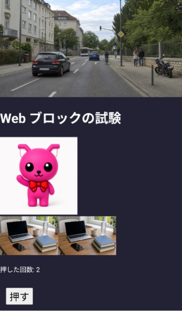 | 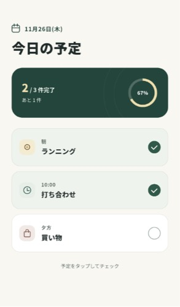 | 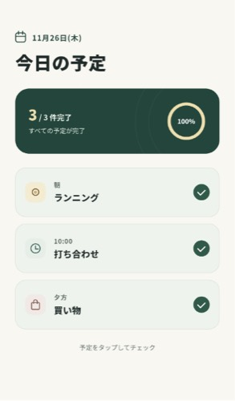 |
| 試験のページ（`asset://` の画像 3 枚） | 裏に回して 3 件目にチェックした後の撮影（2/3 のまま） | 前面に戻した後（3/3） |

- スマートフォンでは spirit がいない（`no spirit`）。製品では、別のマシンの spirit から端末のキャンバスを動かす形になる（この lab の範囲外）

### iPad の実機

iPad Air（第 4 世代、Wi-Fi でつながった実機）で、release の版に入れた自己試験（`lib/self_test.dart`。`check_device.py` と同じ手順をアプリが自分で流し、
結果と画像を自分の Documents に書く）を `tools/ios/device-selftest.sh` で動かした。素材は `devicectl device copy to` でアプリの Documents へ写し、
設定のパスは `@app/…`（アプリのフォルダからのパス）で渡した。Wi-Fi の実機には Mac から端末のポートへつなげないため、制御のポートは使っていない。

| 確かめたこと | iPad Air 4（実機） |
| --- | --- |
| 見本（VRM の MToon・写真・動画・SVG・選択肢・入力欄・音声） | 実機の GPU で描けた（Simulator と見た目が同じ） |
| 大きさ・`%`・`anchor` | 820x997（縦）で置き方どおり |
| スクリプト・状態・タイムライン・`on`・効果音・BGM | 動いた（スクリプトの時計は地方時） |
| WebView: `asset://`・イベント・状態・中の音・撮影 | 動いた（`played ok`、撮影も重なった） |
| 作り置きの呼び出し | 4 ms〜 |

| | | |
| --- | --- | --- |
| 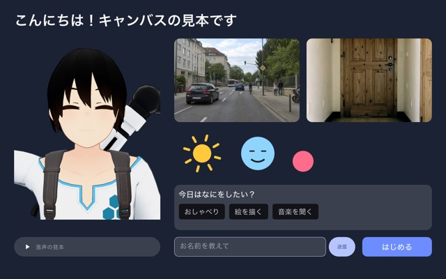 | 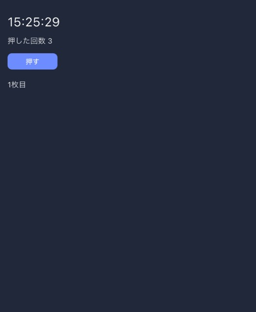 | 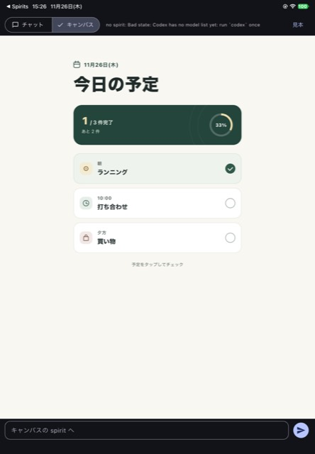 |
| 自己試験の撮影（見本） | 時計・回数・スライド | 実機の画面（`devicectl` の撮影） |

- **画面の実際のタップも WebView に届いた。** Wi-Fi の実機は Appium から見えない（`Unknown device or simulator UDID`）ので、WebDriverAgent を `xcodebuild` で直接起動し（オーナーが iPad で UI Automation を承認）、
  端末の 8100 番の `/wda/tap` で予定の 2 件目と 3 件目を押した。1/3 から 3/3 になった

| | |
| --- | --- |
| 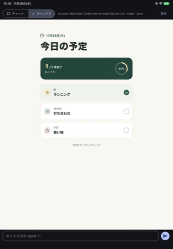 | 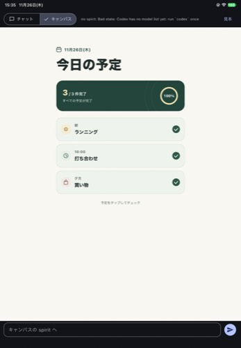 |
| 自己試験の後（1/3） | `/wda/tap` を 2 回（3/3） |
- 自己試験の `behaviors` の `state` に、後の段の状態が入っていた（状態の表そのものを結果に入れていた）。写しを入れるように直した

## Part 8: Windows で確かめる

Windows 11 の開発機（Core i9-12900K・RTX 3080 Ti、Flutter 3.47.2）で、`tools/windows/` の手順で動かした（`send.sh` でソースと素材を送り、
`build.cmd`・`run.cmd` を対話のスケジュールタスクで走らせ、制御のポートは ssh のトンネルで Mac へ）。Windows では Codex が動くので、spirit 込みでも確かめた。

### Windows のための変更

- **WebView:** `webview_flutter` は Windows に対応していない。Windows だけ `webview_all_windows` 1.5.2（WebView2）を使う。両方を `WebPage`（`lib/canvas/web_page.dart`）の裏に隠した。
  WebView2 の版は Flutter のテクスチャとして描かれ（プラットフォームのビューではない）、撮影の口（`takeScreenshot`）を自分で持つ
- **動画:** `video_player` は Windows の実装を持たない（`UnimplementedError: init() has not been implemented`）。`video_player_win` 3.3.2 を足すと再生された
- **スクリプトの時刻:** Windows のスクリプトの JS（QuickJS）は時間帯を知らず、`new Date().getHours()` が UTC になった（15 時が 6 時）。アプリが時差（分）を渡し、
  JS の `Date` の地方時の読み出しを時差で直すようにした（書き込みの側と `toString` は直していない）。WebView の中の JS は時間帯を知っていた
- Codex の場所: `%LOCALAPPDATA%\OpenAI\Codex\bin\<id>\codex.exe`（Codex のアプリが入れたもの、0.167.0-alpha.3.2）を探すようにした。ホームは `USERPROFILE`
- Windows の runner で Flutter GPU を有効に（VRM）、`/utf-8` を足した

### 結果

| 確かめたこと | Windows |
| --- | --- |
| 見本（VRM・写真・動画・SVG・選択肢・入力欄・音声） | 描けた（動画は `video_player_win` を足してから） |
| 大きさ・`%`・`anchor` | 1266x580（横）で置き方どおり |
| スクリプト・状態・タイムライン・`on`・効果音・BGM | 動いた（時刻は直した後に地方時） |
| WebView: `asset://`・イベント・状態・`canvas_web_eval`・ページの中の音 | 動いた（`played ok`） |
| WebView の撮影を重ねる | 重なった（WebView2 の `takeScreenshot`） |
| 作り置きの呼び出し | 11〜17 ms |
| spirit（gpt-6.2-sol）「今の時刻と、今日やることを書き込めるメモの画面を作って」 | 64 秒、道具 6 回（`canvas_web_eval` で書き込みの保存を確かめ、`daily-clock-memo` として保存）、出力 2,542 トークン |

| | | |
| --- | --- | --- |
|  | 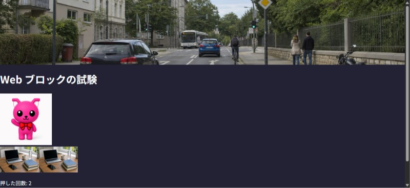 | 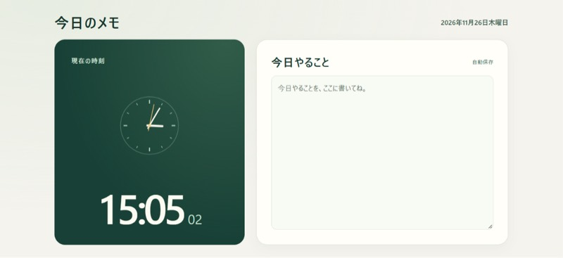 |
| VRM と動画も描けた | WebView2 の撮影 | 時計とメモ（web 要素 1 つ） |

- **窓が前面でないとき・最小化のときの撮影**（`tools/windows/window.ps1` を対話のタスクで走らせて窓を最小化・復元し、その間にページの中でチェックを入れて撮った）:

| 窓 | WebView2 の撮影 | spirit に見せる画像 |
| --- | --- | --- |
| 前面でない（ほかのアプリが前） | 撮れた（0.3 秒、今の 1/3） | 今の絵 |
| 最小化 | 返らない（3 秒で打ち切り） | 前に撮れた絵（1/3。今は 2/3）を描き、「最小化のため撮れず、15:13:09 の絵で古いかもしれない」と添える |
| 復元した後 | 撮れた（今の 3/3） | 今の絵 |

  最初の版は最小化のとき WebView の部分が空になったので、最後に撮れた絵とその時刻を残し、撮れないときはそれを描いて古いことを伝えるようにした（macOS・iOS・Android でも同じ）。
  ページの状態と本文は、最小化の間も `canvas_view` で読めた。復元（`ShowWindow` の 9）は窓を前面に出した

| | | |
| --- | --- | --- |
| 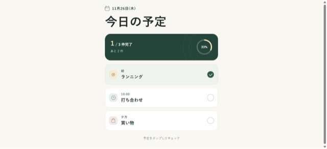 |  | 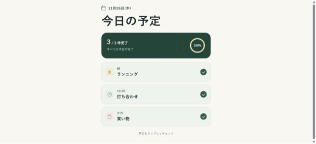 |
| 前面でない: 1/3 | 最小化: 古い絵（1/3、今は 2/3） | 復元: 3/3 |

- **画面の実際のクリックが WebView に届くことは、オーナーが Windows の機で手で触って確かめた**（2026-11-26、「OK だった」）
- 最初の `build.cmd` は、置き場所の解釈を 1 段まちがえて `tools\` で `flutter` を走らせて失敗した（直した）

## Part 9: WebView のスライドの上に体を重ねて、声で解説する

WebView でスライドを作り、その上に spirit の体（VRM）を VTuber のように重ねて、声で解説させられるかを確かめた。

### 作り

- **前面の層（`layer: "front"`）:** WebView は Flutter の要素より常に手前に出る（Part 4）。そこで WebView のさらに上にもう 1 枚、舞台と同じ大きさの層を置き、
  `layer: "front"` の要素だけをそこに描く。前面の要素は、枠全体（透明なところも）でクリックを受け止め、下のページへは通さない（隠れているものは押せない）。
  `tappable` を付ければ、体へのタッチが spirit への出来事になる。spirit に見せる撮影は、舞台 → WebView の絵 → 前面の層の順に重ねる
- **読み上げ（`canvas_speak`、アクション `speak`・`stop_speaking`、スクリプトの `sg.speak`・`sg.stopSpeaking`）:** OS の声を [tts_pcm](https://pub.dev/packages/tts_pcm) 0.2.0 で PCM にし、
  WAV にして audioplayers で鳴らす。並べた順に 1 文ずつ話し、話し終わると `spoken` の出来事（id 付き）が来る。spirit へは起こさずに後で伝える（`later`）
- **声に合わせた口:** PCM の 40 ms ごとの大きさ（RMS、大きいほうから 5% の値を 1 にそろえる）を、鳴らし始めの時刻から読んで VRM の `aa` に入れる。
  `caption` を渡すと、その文字の要素に話している文を出す
- **スクリプトからページを動かす（アクション `web`、`sg.web(id, js)`）:** 「話し終わったら次のスライドへ」をモデルなしで回すために足した。結果は返らない
- **細い枠でも体が収まる:** VRM は枠の高さに合わせて映していたので、縦長の画面で細い枠にすると肩から先が切れた。
  枠の縦横比が足りない（胸から上で 0.9、全身で 0.55 より細い）ときは、その分カメラを引く
- **同じ id でページを置き直したら読み込み直す:** `canvas_clear` の直後に同じ id・同じ HTML の web 要素を置くと、前のページ（3 枚目まで進んだ状態）が残っていた。
  置き直した要素は新しいページとして読み込む

### 確かめたこと

モデルなしの確認は `present_check.py`（3 枚のスライドの web 要素、右下に前面の VRM、下に前面の字幕を置き、スクリプトが 1 文ずつ `sg.speak` して、
3 枚目まで `sg.web` で送る）。

| | macOS | iOS（Simulator） | Android（Pixel 6） | Windows |
| --- | --- | --- | --- | --- |
| 3 枚を読み上げて送り切る（5 文） | 28.3 秒 | 24.4 秒 | 25.7 秒 | 28.8 秒 |
| 実際の画面で WebView の上に体と字幕が出る | 出た | 出た（端末の画面を撮った） | 出た（`screencap`） | 出た（デスクトップを撮った） |
| 体・字幕の上のクリック | 届かない（オーナーが触った） | 未確認 | 届かない（`adb shell input tap`。体の外のタップはページに届く） | 未確認 |

- 口は声に合わせて開いた（話している間に続けて撮った 5 枚のうち、声の大きいところで開いている）
- 撮影（spirit に見せる画像）にも前面の層が重なった
- 最初は前面の要素を `IgnorePointer` にしてクリックを下のページへ通そうとした。Android では通ったが、macOS ではオーナーが体の下の「次へ」を何度押しても届かなかった。
  macOS では、Flutter が WebView の上に描いた部分のクリックを OS が Flutter へ渡し、Flutter はそれを WebView へ渡さない。JS で作り物のクリックを送り直す手もあるが、
  座標の変換と、作り物のクリックで動かないページの問題がある。オーナーと相談し、「隠れているものは押せない」にどの OS も揃え、体へのタッチは spirit への出来事に使う形にした
  （背景をページにして、その上で spirit が歩く・寝る・仕事をする場面で、触ると反応するのに使える）

| | | |
| --- | --- | --- |
| 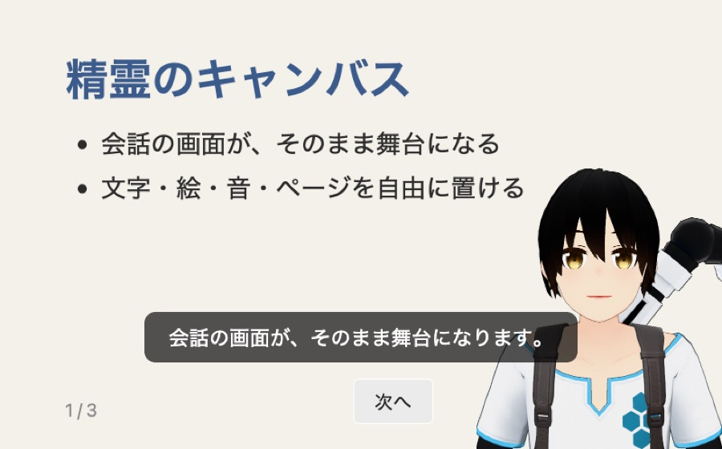 | 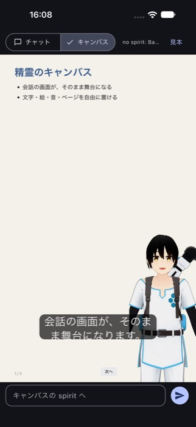 | 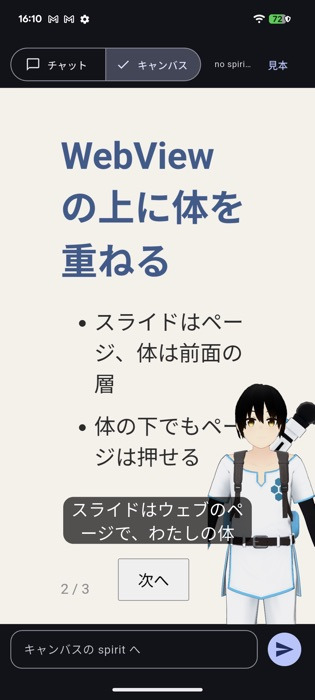 |
| macOS: 撮影に前面の層が重なる | iOS: 細い枠でも体が収まる | Android: 重なった実際の画面 |
| 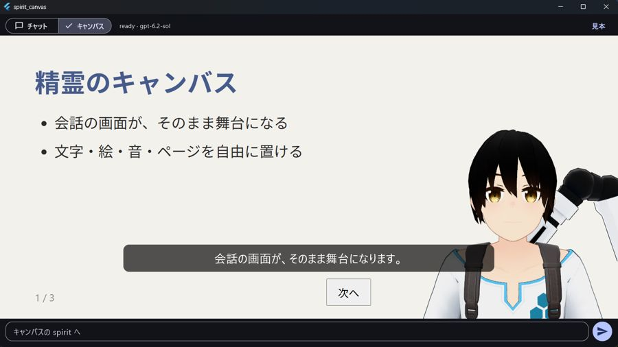 |  | |
| Windows: WebView2 の上に重なる | 話している間の口（右 2 枚で開く） | |

### gpt-6.2-sol に流した結果

「キャンバスで、Spirits Garden を紹介するスライドを 3 枚作って、あなたの体をスライドの上に出して、声で解説して。1 枚ずつ読み終わったら次へ進めて。」（macOS）

- 195 秒、道具 14 回、出力 6,026 トークン。スライドは web 要素 1 つ（字幕もページの中）、体は `layer: "front"` の VRM、スクリプトが文ごとに `sg.speak` し、
  `spoken` で次の文・次のスライドへ進めた。最後に「もう一度聞く」を出し、`spirits-garden-intro` として保存した（[results/present-sol-scene.json](results/present-sol-scene.json)）
- spirit は最後まで読み上げを見届けてから返事をした（スクリプトを 1 回書き直した）
- 後で窓を広げたとき、resize の通知で起き、字幕を体と重ならない左下へ動かした

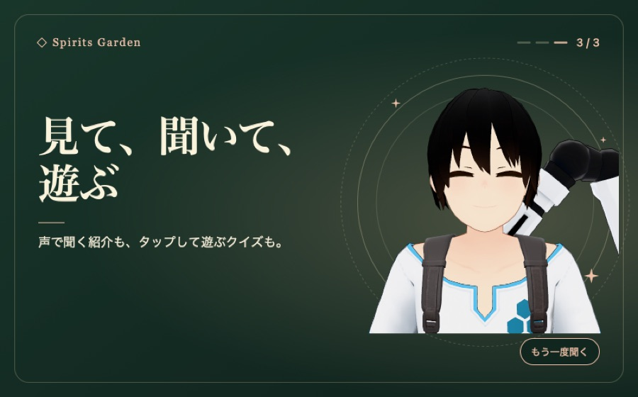

### 分かった制約

- 前面の要素の枠は四角い。体のまわりの透明なところもページを塞ぐので、枠は体に合わせて小さくし、ページのボタンの上に置かない（spirit への指示にも書いた）
- 声は OS のもの。tts_pcm の lab の計測では、Apple の Kyoko は全部できてから届く（0.75〜1 秒）ので、話し始めに間が空きうる（ここでは測っていない）。spirit の本番の声（クローン TTS）にするなら、PCM を受けて同じ形で口を動かせる
- 口は `aa` だけ（母音の形は見ていない）

## 結論が成り立つ範囲と、まだ見ていないこと

- spirit（モデル）込みで動かしたのは macOS と Windows。iOS（Simulator）と Android（Pixel 6）は、画面の側をモデルなしで確かめた（Part 7）。iOS の実機は動かしていない
- Claude（Opus）では流していない。各シナリオ 1 回で、ばらつきは見ていない
- 選択肢・ボタンは画面で実際にクリックした（s2、s4）。入力欄の `submit`、`tap`、動画・音声の `ended` は、モデルにつないだ状態では確かめていない（見本で描けることだけ）
- 動画・音声は、手元の素材（labs の `tests/assets`）か https の URL だけ。spirit が新しく画像・音声を作る道具は無い
- 撮影は 960x600（`pixelRatio` 0.75）で spirit に渡している。小さい文字が読めるかは見ていない
- Part 2 は Sol だけ、各 1 回。`on`・タイムライン・状態を spirit が使う場面は観測できていない（道具としてはモデルなしで動く）。指示文を変えた比べもしていない
- スクリプトの安全は lab の範囲（無限ループで固まる）。複数のスクリプトが同じ要素を書き換えるときの順序も決めていない
- Part 3 は c1・c2 の各 1 回。保存するのは、保存した時点の画面と状態そのもの（遊んだ途中の値も入る）。作り置きの版の管理、spirit ごと・家族ごとの置き場所は決めていない

## 次の一手（この lab の結果から）

Part 1 で挙げた「押したときの結果を宣言する」「時間の並び」「spirit が書くスクリプト」「通知の区別」は Part 2、「作り置きの保存・呼び出し・差し替え」と音は Part 3、WebView は Part 4、画面の大きさに合わせるのは Part 5 で作った。残り:

1. **スマートフォンで spirit を動かす**（別のマシンの spirit から端末のキャンバスを動かす形。この lab の範囲外）
2. **安全領域（ノッチ・ホームバー）を渡す。** 大きさと向きは Part 5 で渡すようにした。スマートフォンでは、隠れる部分を避けるための余白も要る
3. **spirit がモードを切り替える道具。** チャットのまま頼まれた絵を、そのまま見せられるように。ユーザーが自分でチャットに戻した直後に戻さないよう、提案を出して押されたら切り替える形などを選ぶ
4. **スクリプトを製品の形で動かす。** 別の isolate かプロセス、実行時間の上限、スクリプトどうしの順序
5. **作り置きの置き場所と共有。** spirit ごと・家族ごと、版、アセット（画像・音）を含めた受け渡し。製品ではアセットノードの `asset://` で参照する形が合いそう（未検討）
6. **音の素材。** 合成の素材は仮。作り置きの BGM・効果音を揃えるか、音楽の生成を道具にする。spirit の声（TTS）と重なったときに BGM を下げる
7. **`notify: "none"` の扱い。** spirit が自分で聞かないことにした操作も、画面を読めば分かった。ただ、聞かれるまで知らない。会話の記憶に残すかどうかを決める
8. 大きな SVG を書く遅さ（出力 8,000〜11,000 トークン）は、作り置きで避けられる場面が多い。ゼロから描く場面のために、画像の生成の道具を足して比べる

## Run

```sh
# 共有の素材、Seed-san（VRM、VirtualCast, Inc.、VRM Public License 1.0）、.vrma を取り、音を合成する
mise -C 2026/11/26/spirit-canvas run assets
# ビルド（clean から）と起動。codex にログインしている必要がある
mise -C 2026/11/26/spirit-canvas run build
CONTROL_PORT=8813 mise -C 2026/11/26/spirit-canvas run run
# 別の端末から: 送る・押す・状態
python3 2026/11/26/spirit-canvas/drive.py s1-intro send "キャンバスで自己紹介して"
python3 2026/11/26/spirit-canvas/drive.py s2 event press <button id>
# 道具を直に呼ぶ（モデルなし）
curl -s -XPOST "localhost:8813/tool?name=canvas_state" --data-binary '{"set":{"n":1}}'
```

Windows: `HOST=<ssh の宛先> tools/windows/send.sh` で送り、Windows の機で `build.cmd` と `run.cmd` を対話のスケジュールタスク（`schtasks /create ... /it`）として走らせる（ssh のセッションからはプラグインのリンクをたどれず、GUI も出ないため）。
制御のポートは `ssh -N -L 8816:127.0.0.1:8816 <host>` で手元へ。

iOS・Android: `DEVICE=<udid> mise -C 2026/11/26/spirit-canvas run run-ios`・`DEVICE=<adb serial> mise -C 2026/11/26/spirit-canvas run run-android`（spirit はつながらない。
`python3 2026/11/26/spirit-canvas/check_device.py ios 8814` などで確かめる。Android は初回の `flutter run` で入ったあと、もう一度実行すると素材が写る）。

環境変数: `MODEL`（既定 `gpt-6.2-sol`）、`EFFORT`、`CONTROL_PORT`（既定 0 = 切る）、`START_MODE`（`canvas` / `chat`）、
`VRM_PATH`・`VRMA_PATH`（既定は `work/assets`）、`ABBREVIATE_VIEW`（既定 `1`。`0` で SVG を全文返す、s1〜s7 の条件）。
画面の右上の「見本」は、モデルを使わずに `demo_scene.dart` を置きます。
作り置きは `scenes/`、spirit が保存した画面は `work/scenes/` に入ります。

スライドの解説（Part 9）のモデルなしの確認: `python3 2026/11/26/spirit-canvas/present_check.py <名前> <ポート>`（画像は `work/logs/<名前>/`）。
Windows のデスクトップを撮るには `tools/windows/screen.vbs` を対話のタスクで走らせる（コンソールの窓を出さずに `logs\screen.png` へ）。

`mise -C 2026/11/26/spirit-canvas run`（既定）は解析とキャンバスのモデルのテストだけを行います。

## Dependencies

`app/pubspec.lock` が解決した版。flutter_vrm は commit `6cdf97d`、flutter_scene はその lab と同じ upstream の commit `0e263be`（`dependency_overrides`）。
flutter_svg 2.5、video_player 2.14、audioplayers 6.8、flutter_js 0.8.7（Part 2）、webview_flutter 4.14.1・webview_flutter_wkwebview 3.27.2（Part 4）、webview_flutter_android（Part 7）、webview_all_windows 1.5.2・webview_platform_interface 1.5.2・video_player_win 3.3.2（Part 8）、tts_pcm 0.2.0（Part 9）。
